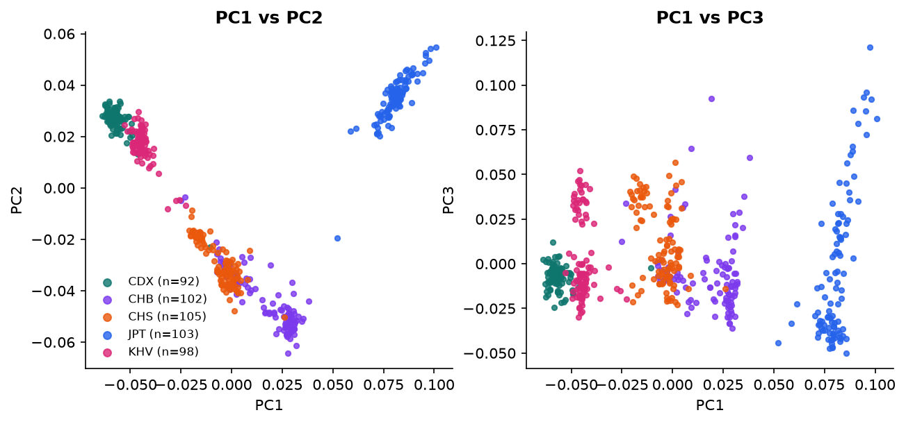
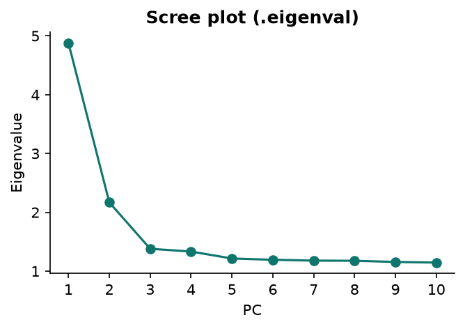

# L08 族群結構與主成分分析

## 學習目標

- 解釋主成分分析（PCA）如何描述族群結構，以及為什麼要把主成分放進 GWAS 模型。
- 請 AI 寫出 LD 修剪、排除親屬、計算 PCA、投影所有樣本的流程。
- 畫出 PC1 對 PC2 散布圖並解讀。
- 了解基因型填補（imputation）在大型研究中的角色。

## 時間配置

| 段落 | 時間 | 內容 |
|---|---|---|
| 觀念 | 15 分鐘 | PCA、親緣、填補 |
| 實作 | 35 分鐘 | 執行 PCA 與畫圖 |
| 驗證 | 10 分鐘 | 檢查輸出檔與圖 |

## 1. PCA 在 GWAS 中的用途

PCA 把數十萬個 SNP 濃縮成少數幾個主成分。前幾個主成分通常反映祖源差異。把它們放進迴歸模型當共變項，就能調整 [L05](L05.md) 提到的族群分層。

做 PCA 前要注意三件事：

1. **LD 修剪：** 只用近似獨立的 SNP，避免某些高度連鎖區域主導主成分。
2. **排除高 LD 區域：** 例如第 6 號染色體的 HLA 區。GWASTutorial 提供一份 hg19 座標的高 LD 區域清單。
3. **先用無親緣的樣本計算，再把所有樣本投影上去：** 親屬會扭曲主成分。

## 2. 實作

以下指令取自 [GWASTutorial: PCA](https://cloufield.github.io/GWASTutorial/05_PCA/)。

**步驟 1：建立高 LD 區域清單的 SNP 集合**

```bash
plinkFile="../04_Data_QC/sample_data.clean"

plink \
    --bfile ${plinkFile} \
    --make-set high-ld-hg19.txt \
    --write-set \
    --out hild
```

**步驟 2–4：LD 修剪、排除親屬、計算 PCA**

```bash
outPrefix="plink_results"
threadnum=2
hildset="hild.set"

# LD 修剪，排除高 LD 與 HLA 區域
plink2 \
        --bfile ${plinkFile} \
        --maf 0.01 \
        --threads ${threadnum} \
        --exclude ${hildset} \
        --indep-pairwise 500 50 0.2 \
        --out ${outPrefix}

# 用 KING 親緣係數排除親屬
plink2 \
        --bfile ${plinkFile} \
        --extract ${outPrefix}.prune.in \
        --king-cutoff 0.0884 \
        --threads ${threadnum} \
        --out ${outPrefix}

# 在無親緣樣本上計算 10 個主成分
plink2 \
        --bfile ${plinkFile} \
        --keep ${outPrefix}.king.cutoff.in.id \
        --extract ${outPrefix}.prune.in \
        --freq counts \
        --threads ${threadnum} \
        --pca approx allele-wts 10 \
        --out ${outPrefix}
```

KING 親緣係數 0.0884 大約是二等親的下界（Manichaikul et al., 2010），所以這一步會排除二等親以上的親屬。

**步驟 5：把所有樣本投影到主成分上**

```bash
plink2 \
        --bfile ${plinkFile} \
        --threads ${threadnum} \
        --read-freq ${outPrefix}.acount \
        --score ${outPrefix}.eigenvec.allele 2 6 header-read no-mean-imputation variance-standardize \
        --score-col-nums 7-16 \
        --out ${outPrefix}_projected
```

輸出 `plink_results_projected.sscore`，欄位是 `#FID IID ALLELE_CT NAMED_ALLELE_DOSAGE_SUM PC1_AVG … PC10_AVG`，下一章會用它當共變項。

## 3. 在 VS Code 用 Claude Code 逐步操作

<span class="vg-step">1</span> **確認上一章的輸出。** 檔案總管展開 `results/qc/`，要看得到 `sample_data.clean.bed`、`.bim`、`.fam`。沒有就先回 [L07](L07.md)。

<span class="vg-step">2</span> **Plan 模式要計畫。** 權限模式切 **Plan**，貼上：

!!! prompt "提示詞"

    ```text
    請規劃 scripts/03_pca.sh，內容是 L08 講義的步驟 1–5（--make-set 高 LD 區域、
    plink2 LD 修剪、--king-cutoff 0.0884、--pca approx allele-wts 10、--score 投影），
    指令照 GWASTutorial 原樣。輸入 results/qc/sample_data.clean，
    高 LD 清單用 GWASTutorial/05_PCA/high-ld-hg19.txt，輸出全部放 results/pca/。
    執行完回報 king.cutoff.in.id 與 king.cutoff.out.id 各有幾人（扣掉表頭）。
    ```

<span class="vg-step">3</span> **審計畫，再切 Manual 寫檔。** 檢查 `--indep-pairwise 500 50 0.2`、`--king-cutoff 0.0884`、`--score-col-nums 7-16` 都和本章第 2 節一樣，然後切回 **Manual**，在差異畫面確認後接受。

<span class="vg-step">4</span> **執行並驗證。** 終端機執行 `bash scripts/03_pca.sh`，然後輸入 `/gwas-step-check results/pca/plink_results.log`，看排除了幾位親屬。

<span class="vg-step">5</span> **畫圖。** 貼上：

!!! prompt "提示詞"

    ```text
    請寫 scripts/03_plot_pca.py，讀取 results/pca/plink_results_projected.sscore，
    畫 PC1 對 PC2、PC1 對 PC3 兩張散布圖，存成 figures/pca.png。
    用 GWASTutorial/01_Dataset/integrated_call_samples_v3.20130502.ALL.panel
    的 pop 欄位上色，圖例標出每個族群的人數。
    另外讀 results/pca/plink_results.eigenval 畫陡坡圖（scree plot）存成 figures/pca_scree.png。
    ```

<span class="vg-step">6</span> **看圖。** 在檔案總管點 `figures/pca.png`，VS Code 會直接顯示圖片。也可以把圖拖進提示框（按住 ++shift++），問 Claude「這張圖的族群分群跟講義第 4 節的說法一致嗎？」

!!! warning "新版 PLINK 2 跑 PCA 會報錯"
    本課程用 2026 年 11 月版的 PLINK 2 照原指令執行 `--pca`，會出現錯誤：MAF 最低為 0.01，低於 0.25/√500 ≈ 0.0112，PCA 不穩定。新版 PLINK 2 的說明指出，PCA 用 sqrt(2p(1-p)) 標準化每個變異，p 很小時單一罕見變異可能主導結果，所以改為直接報錯。要重現 GWASTutorial 的設定，在 `--pca` 那一行加上 `--grm-maf 0.01 yes-really`。遇到這種錯誤，先把錯誤訊息交給 Claude 解釋（`@terminal:名稱`），再決定怎麼改。

## 4. 解讀

本練習的 504 人都屬於 1000 Genomes 的東亞超族群，但包含多個子族群（例如日本東京、北京漢人、南方漢人等）。上色後的散布圖應能看到子族群在主成分上分群。這說明**即使都是「東亞人」，仍有需要調整的族群結構**。

### 實跑結果

本課程實跑時，`--king-cutoff 0.0884` 排除 0 人，500 人全部進入 PCA；LD 修剪後保留 196,752 個 SNP。

<figure markdown="span">
  { width="100%" }
  <figcaption>PC1 對 PC2、PC1 對 PC3，依 1000 Genomes 族群上色（本課程在 GitHub Actions 實跑，詳見[實跑結果](../results.md)）</figcaption>
</figure>

<figure markdown="span">
  { width="60%" }
  <figcaption>前 10 個主成分的特徵值（本課程在 GitHub Actions 實跑，詳見[實跑結果](../results.md)）</figcaption>
</figure>


## 5. 補充：基因型填補

晶片只測得數十萬個 SNP。大型研究會用參考面板把未測到的變異「填補」出來，增加檢定的變異數，也讓不同晶片的世代可以合併。

| 項目 | 例子 |
|---|---|
| 填補服務 | Michigan Imputation Server（Das et al., 2016）、TOPMed Imputation Server |
| 參考面板 | 1000 Genomes Phase 3、TOPMed（Taliun et al., 2021） |
| 頂尖期刊實例 | Kim 等人 2024 年 Nature Genetics 的多族群帕金森氏症 GWAS，先用 Eagle2 定相（phasing），再用 Minimac3 以 1000 Genomes Phase III 與 UK10K 參考面板填補 |

本課程的練習資料已是 1000 Genomes 的定序資料，所以不需要填補。

## 驗證清單

- [ ] `results/pca/plink_results_projected.sscore` 存在，且有 PC1_AVG 到 PC10_AVG 共 10 欄主成分。
- [ ] 我知道有幾個樣本被 `--king-cutoff` 排除在 PCA 計算之外。
- [ ] 散布圖依子族群上色後，能看到分群。

## 延伸影片

本章沒有另外指定影片，請沿用前一章的影片，或參考[影片總表](../videos.md)。

## 參考文獻

- Manichaikul A, et al. Robust relationship inference in genome-wide association studies. *Bioinformatics*. 2010;26(22):2867-2873. doi:10.1093/bioinformatics/btq559
- Das S, et al. Next-generation genotype imputation service and methods. *Nat Genet*. 2016;48(10):1284-1287. doi:10.1038/ng.3656
- Taliun D, et al. Sequencing of 53,831 diverse genomes from the NHLBI TOPMed Program. *Nature*. 2021;590(7845):290-299. doi:10.1038/s41586-021-03205-y
- Kim JJ, et al. Multi-ancestry genome-wide association meta-analysis of Parkinson's disease. *Nat Genet*. 2024;56:27-36. doi:10.1038/s41588-023-01584-8
- GWASTutorial: PCA. <https://cloufield.github.io/GWASTutorial/05_PCA/>
