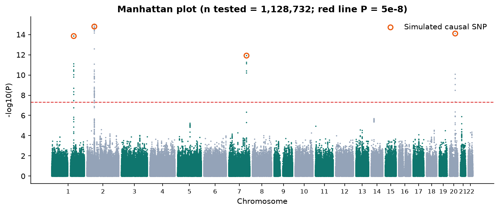
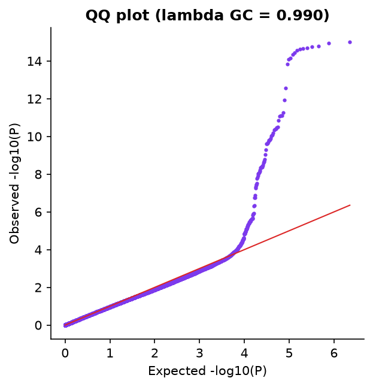

# L09 關聯分析：從 logistic regression 到混合模型

## 學習目標

- 用 PLINK 2 對二元性狀做全基因體 logistic regression，並調整主成分。
- 解釋 Firth 校正為什麼適合病例對照資料。
- 說明混合模型與全基因體迴歸（REGENIE、SAIGE、BOLT-LMM）解決了什麼問題，以及頂尖期刊實際怎麼用。
- 請 AI 執行 REGENIE 兩步驟分析，並與 PLINK 2 結果比較。

## 時間配置

| 段落 | 時間 | 內容 |
|---|---|---|
| 觀念 | 15 分鐘 | 迴歸模型、Firth、混合模型 |
| 實作 | 35 分鐘 | PLINK 2 GWAS；有時間再做 REGENIE |
| 驗證 | 10 分鐘 | 是否找回模擬的致病位點 |

## 1. PLINK 2 的 logistic regression

以下指令取自 [GWASTutorial: Association test](https://cloufield.github.io/GWASTutorial/06_Association_tests/)：

```bash
genotypeFile="../04_Data_QC/sample_data.clean"
phenotypeFile="../01_Dataset/1kgeas_binary.txt"
covariateFile="../05_PCA/plink_results_projected.sscore"
covariateCols=6-10
colName="B1"
threadnum=2

plink2 \
    --bfile ${genotypeFile} \
    --pheno ${phenotypeFile} \
    --pheno-name ${colName} \
    --maf 0.01 \
    --covar ${covariateFile} \
    --covar-col-nums ${covariateCols} \
    --glm hide-covar firth firth-residualize single-prec-cc \
    --threads ${threadnum} \
    --out 1kgeas
```

逐項說明：

| 參數 | 意義 |
|---|---|
| `--pheno`、`--pheno-name B1` | 表現型檔與欄位名稱 |
| `--covar-col-nums 6-10` | 共變項取 `.sscore` 的第 6 到 10 欄，共 5 個主成分欄位。欄位怎麼編號（是否把 `#FID` 算第 1 欄）會決定實際用到哪 5 個主成分，請 AI 對照 PLINK 2 文件說明 |
| `--glm` | 廣義線性模型；二元性狀自動用 logistic regression |
| `hide-covar` | 輸出只列 SNP 的結果，不列共變項 |
| `firth` | 所有變異都使用 Firth 校正的 logistic regression |
| `firth-residualize`、`single-prec-cc` | 加速 Firth 計算的選項，細節見 PLINK 2 文件的 `--glm` 說明 |

**為什麼用 Firth：** 當變異很罕見或病例很少時，一般 logistic regression 的估計可能不收斂或偏大。Firth 校正加入懲罰項，讓估計穩定。

GWASTutorial 的執行紀錄顯示：載入 500 個樣本（248 病例、250 對照）、1,224,104 個變異，MAF 篩選後剩 1,128,732 個變異，結果寫入 `1kgeas.B1.glm.firth`。

本課程實跑（PLINK 2，2026-11-07 版）的 log 同樣是 248 病例、250 對照、1,128,732 個變異。

!!! note "FIRTH_CONVERGE_FAIL"
    GWASTutorial 的輸出中，部分變異的 `ERRCODE` 欄出現 `FIRTH_CONVERGE_FAIL`，表示該變異的模型沒有收斂，結果為 NA。本課程用新版 PLINK 2 實跑時，所有變異的 `ERRCODE` 都是 `.`，沒有出現這個錯誤。不論版本，都請 AI 統計 `ERRCODE` 不是 `.` 的變異數，並在後續畫圖時排除。

## 2. 為什麼大型研究改用混合模型

PLINK 的迴歸假設樣本彼此獨立。大型生物資料庫裡常有親屬或隱性的親緣關係，直接排除會損失樣本。混合模型把「全基因體的遺傳相似度」當成隨機效應，可以保留親屬並調整族群結構。

| 工具 | 主要特點 | 原始文獻 |
|---|---|---|
| BOLT-LMM | 貝氏混合模型，適合大型世代的連續性狀 | Loh et al., 2015 |
| SAIGE | 用鞍點近似（saddlepoint approximation）處理病例對照比例極不平衡的二元性狀 | Zhou et al., 2018 |
| REGENIE | 兩步驟全基因體脊迴歸，可同時分析多個表現型，計算快 | Mbatchou et al., 2021 |

**頂尖期刊實例（皆為 Nature Genetics，方法段落原文查證）：**

- **長新冠 GWAS（Lammi et al., 2025）：** 統一分析計畫建議各世代使用 REGENIE 跑第 1–22 與 X 染色體，少數世代使用 SAIGE 或 PLINK2；最少共變項為年齡、年齡平方、性別、年齡×性別與前 10 個主成分。
- **多族群憂鬱症 GWAS（Meng et al., 2024）：** CKB、BioME、Genes and Health 等世代用 SAIGE 混合模型；CONVERGE 研究先用 BOLT-LMM，再用 PLINK logistic regression 取得勝算比。
- **肥厚型心肌病變 GWAS（Tadros et al., 2025）：** UK Biobank 的功能喪失變異負荷檢定（burden test）使用 REGENIE 流程並加 Firth 校正。

可以看到，**大型合作研究常讓不同世代用不同工具，最後再統合分析**（[L11](L11.md)）。

## 3. REGENIE 兩步驟

REGENIE 的第一步用脊迴歸建立每個人的「多基因預測值」，第二步逐一檢定 SNP 時把這個預測值當成偏移量。以下指令取自 [GWASTutorial: REGENIE](https://cloufield.github.io/GWASTutorial/32_whole_genome_regression/)，參數意義可對照 [REGENIE 官方文件](https://rgcgithub.github.io/regenie/options/)。

```bash
plinkFile=../01_Dataset/1KG.EAS.auto.snp.norm.nodup.split.rare002.common015.missing
phenoFile=../01_Dataset/1kgeas_binary_regenie.txt
covarFile=../05_PCA/plink_results_projected.sscore
covarList="PC1_AVG,PC2_AVG,PC3_AVG,PC4_AVG,PC5_AVG,PC6_AVG,PC7_AVG,PC8_AVG,PC9_AVG,PC10_AVG"
extract=../05_PCA/plink_results.prune.in

# REGENIE 需要表頭是 FID，不是 #FID
sed -i 's/#FID/FID/' ../05_PCA/plink_results_projected.sscore
mkdir tmpdir

# 第一步：用修剪後的 SNP 建立預測值
regenie \
  --step 1 \
  --bed ${plinkFile} \
  --extract ${extract} \
  --phenoFile ${phenoFile} \
  --covarFile ${covarFile} \
  --covarColList ${covarList} \
  --bt \
  --bsize 1000 \
  --lowmem \
  --lowmem-prefix tmpdir/regenie_tmp_preds \
  --out 1kg_eas_step1_BT

# 第二步：逐一檢定 SNP，p < 0.01 的變異改用 Firth 近似
regenie \
  --step 2 \
  --bed ${plinkFile} \
  --ref-first \
  --phenoFile ${phenoFile} \
  --covarFile ${covarFile} \
  --covarColList ${covarList} \
  --bt \
  --bsize 400 \
  --firth --approx --pThresh 0.01 \
  --pred 1kg_eas_step1_BT_pred.list \
  --out 1kg_eas_step1_BT
```

!!! warning "注意：這裡的輸入檔"
    GWASTutorial 的 REGENIE 範例使用的是 QC 前的原始檔。請 AI 說明差異，再試著改用 `sample_data.clean` 重跑，比較兩次的結果。這是練習「看懂 AI 與教學文件在做什麼」的好機會。

`sed -i` 會直接修改 `.sscore` 檔的表頭。依 [L04](L04.md) 的審查清單，這屬於「覆寫檔案」，執行前要確認你知道它改了什麼。

## 4. 在 VS Code 用 Claude Code 逐步操作

<span class="vg-step">1</span> **Plan 模式要計畫。** 權限模式切 **Plan**，貼上：

!!! prompt "提示詞"

    ```text
    請規劃 scripts/04_gwas_plink2.sh，內容是 L09 講義第 1 節的 plink2 --glm 指令，參數照原樣。
    輸入：results/qc/sample_data.clean、GWASTutorial/01_Dataset/1kgeas_binary.txt、
    results/pca/plink_results_projected.sscore；輸出放 results/gwas/，前綴 1kgeas。
    另外請先說明 --covar-col-nums 6-10 在這個 .sscore 檔實際對應到哪 5 個欄位，
    要引用 PLINK 2 文件的說法，不確定就說不確定。
    ```

<span class="vg-step">2</span> **審計畫。** 特別看它對 `--covar-col-nums 6-10` 的說明是否有引用文件。這是本章最容易出錯的地方。

<span class="vg-step">3</span> **切 Manual，寫檔、執行。** 終端機執行 `bash scripts/04_gwas_plink2.sh`。

<span class="vg-step">4</span> **驗證。** 先問 Claude：

```text
請讀 @results/gwas/1kgeas.log，告訴我分析了幾個樣本、幾個變異，
和預期值（500 個樣本、1128732 個變異）比對是否一致，每個數字都貼出 log 裡那一行原文。
```

再請 Claude 回報：

!!! prompt "提示詞"

    ```text
    請讀 results/gwas/1kgeas.B1.glm.firth（tab 分隔），回報：
    (1) log 裡的病例數與對照數；(2) 分析的變異數；
    (3) ERRCODE 不是 "." 的變異有多少個、各是什麼錯誤；
    (4) P 值最小的 10 個變異（ID、A1、OR、P）；
    (5) causal.snplist 裡 5 個 SNP 的 P 值。
    每個數字都要說明是從哪個檔案、哪一欄讀出來的。
    ```

## 5. 驗證：找回致病位點

模擬表現型的 5 個致病 SNP 列在 `01_Dataset/causal.snplist`：

```text
2:55620927:G:A
8:97094292:C:T
20:42758834:T:C
7:134326056:G:T
1:167562605:G:A
```

GWASTutorial 列出的顯著位點中，`20:42758834:T:C` 與 `1:167562605:G:A` 就是致病 SNP 本身；第 2 與第 7 號染色體列出的則是鄰近的另一個 SNP（`2:55513738:C:T`、`7:134368632:T:G`），P 值都小於 10⁻¹¹。這呼應 [L05](L05.md) 的連鎖不平衡：**最顯著的 SNP 不一定是致病變異本身。**

### 實跑結果

本課程實跑的 Manhattan plot 與 QQ plot（λGC = 0.990），P &lt; 5×10⁻⁸ 的變異共 63 個：

<figure markdown="span">
  { width="100%" }
  <figcaption>Manhattan plot，橘色圈是模擬致病 SNP（本課程在 GitHub Actions 實跑，詳見[實跑結果](../results.md)）</figcaption>
</figure>

<figure markdown="span">
  { width="55%" }
  <figcaption>QQ plot（本課程在 GitHub Actions 實跑，詳見[實跑結果](../results.md)）</figcaption>
</figure>

5 個致病 SNP 中，`8:97094292:C:T` 的 MAF 只有 0.002，被 QC 的 `--maf 0.01` 排除，所以只有 4 個進入 GWAS，P 值都小於 10⁻¹¹。實跑中第 1、7、20 號染色體最顯著的就是致病 SNP 本身；第 2 號染色體最顯著的是 `2:55587876:T:C`，致病 SNP `2:55620927:G:A` 排第三。逐項數字見[實跑結果](../results.md)。

## 驗證清單

- [ ] 病例 248 人、對照 250 人、分析 1,128,732 個變異，與 GWASTutorial 一致。
- [ ] 至少在第 1 號與第 20 號染色體找回致病 SNP。
- [ ] 我能說出至少一篇頂尖期刊論文使用的關聯分析工具。

## 練習

??? question "第 8 號染色體的致病 SNP 沒有被找到，可能的原因是什麼？"

??? success "查看答案"

    可能原因包括：樣本數只有 500 人，檢定力不足；模擬時各致病 SNP 的效應大小與對偶基因頻率不同，有些效應較小或頻率較低；也可能該 SNP 的 Firth 模型沒有收斂。可以請 AI 查出這個 SNP 在結果檔中的 P 值、A1_FREQ 與 ERRCODE 再判斷。

## 延伸影片

| 影片 | 頻道 | 上架日 | 長度 | 觀看次數 |
|---|---|---|---|---|
| [GWAS in Plink](https://www.youtube.com/watch?v=7QMSZx3io-Q) | math et al | 2019-02-27 | 16:51 | 52,988 |
| [Genome-Wide Association Studies (GWAS) using R by Andy Chen ｜ Tunis R User Group ｜ Workshop #2](https://www.youtube.com/watch?v=Oq85Jff9i2U) | Tunis R User Group | 2023-06-05 | 2:17:30 | 19,128 |
| [GWAS on the Research Analysis Platform using regenie](https://www.youtube.com/watch?v=762PVlyZJ-U) | DNAnexus | 2021-11-03 | 49:40 | 11,890 |
| [Running GWAS with biobank scale samples](https://www.youtube.com/watch?v=JinzsS1nqM0) | International Statistical Genetics Workshop | 2021-05-31 | 26:04 | 1,526 |
| [Genome wide association studies (GWAS) part 3: Analyzing cohorts, big biobanks, and cohorts combined](https://www.youtube.com/watch?v=vk5aZauG6a8) | International Statistical Genetics Workshop | 2026-05-17 | 20:57 | 659 |

觀看次數與上架日於 2026-11-19 直接取自 YouTube 影片頁，之後會變動。

## 參考文獻

- Loh PR, et al. Efficient Bayesian mixed-model analysis increases association power in large cohorts. *Nat Genet*. 2015;47(3):284-290. doi:10.1038/ng.3190
- Zhou W, et al. Efficiently controlling for case-control imbalance and sample relatedness in large-scale genetic association studies. *Nat Genet*. 2018;50(9):1335-1341. doi:10.1038/s41588-018-0184-y
- Mbatchou J, et al. Computationally efficient whole-genome regression for quantitative and binary traits. *Nat Genet*. 2021;53(7):1097-1103. doi:10.1038/s41588-021-00870-7
- Lammi V, et al. Genome-wide association study of long COVID. *Nat Genet*. 2025;57:1402-1417. doi:10.1038/s41588-025-02100-w
- Meng X, et al. Multi-ancestry genome-wide association study of major depression aids locus discovery, fine mapping, gene prioritization and causal inference. *Nat Genet*. 2024;56:222-233. doi:10.1038/s41588-023-01596-4
- Tadros R, et al. Large-scale genome-wide association analyses identify novel genetic loci and mechanisms in hypertrophic cardiomyopathy. *Nat Genet*. 2025;57:530-538. doi:10.1038/s41588-025-02087-4
