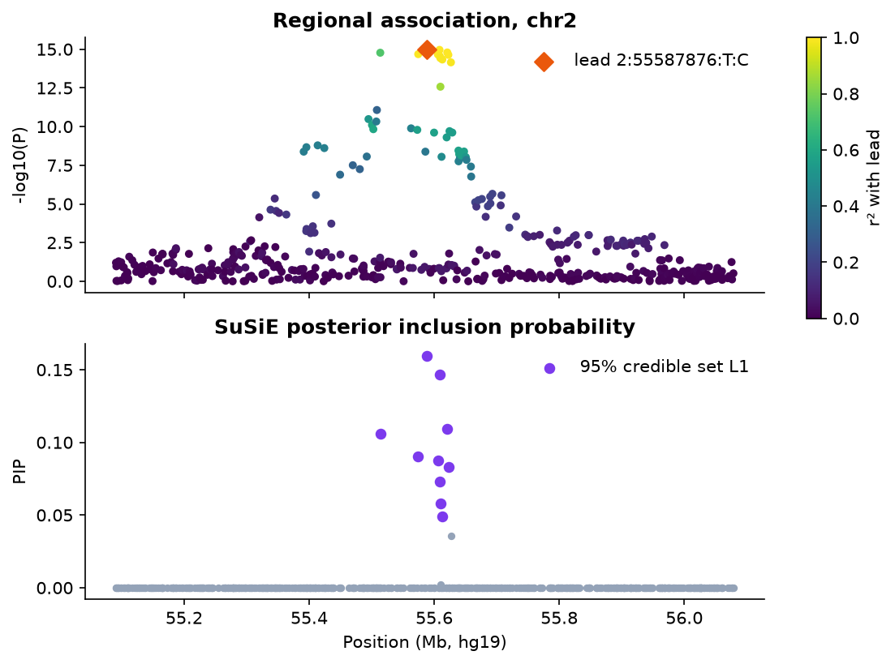

# L12 從訊號到基因：精細定位、共定位與基因優先排序

## 學習目標

- 解釋為什麼 GWAS 顯著位點不等於致病變異，也不等於致病基因。
- 說明精細定位（fine-mapping）的後驗納入機率（PIP）與可信集合（credible set）。
- 說明共定位（colocalization）如何判斷 GWAS 與 eQTL 是否共享同一個致病變異。
- 認識頂尖期刊常用的基因優先排序工具：MAGMA、FUMA、SMR、TWAS、PoPS。

## 時間配置

| 段落 | 時間 | 內容 |
|---|---|---|
| 觀念 | 25 分鐘 | 精細定位、共定位、基因排序 |
| 論文拆解 | 15 分鐘 | 頂尖期刊怎麼組合這些方法 |
| 實作 | 20 分鐘 | 請 AI 解說 SuSiE 與 coloc 程式 |

## 1. 從位點到基因的三個問題

GWAS 找到一個顯著位點之後，還有三個問題：

1. **哪個變異是致病的？** 位點內有幾十到幾百個因 LD 而一起顯著的 SNP。→ 精細定位
2. **它影響哪個基因？** 多數 GWAS 變異落在非編碼區，最近的基因不一定是目標基因。→ 共定位、SMR、TWAS
3. **整體指向哪些生物路徑？** → 基因與基因集分析（MAGMA）、基因優先排序（PoPS）

## 2. 精細定位

精細定位為位點內每個變異計算**後驗納入機率**（posterior inclusion probability, PIP），也就是它是致病變異的機率；再找出累積機率達 95% 的最小變異集合，稱為 **95% 可信集合**。

SuSiE（Sum of Single Effects）把位點內的效應拆成數個「單一效應」，每個單一效應各有一個可信集合，因此能處理一個位點內有多個致病變異的情況（Wang et al., 2020）。SuSiE-RSS 只需要摘要統計與 LD 矩陣（Zou et al., 2022）。

GWASTutorial 的[精細定位章節](https://cloufield.github.io/GWASTutorial/12_fine_mapping/)示範流程：先用 PLINK 算出位點內 SNP 的 LD 相關矩陣，再在 R 用 susieR：

```bash
plink \
  --bfile ${plinkFile} \
  --keep-allele-order \
  --r square \
  --extract sig_locus.snplist \
  --out sig_locus_mt
```

```r
library(susieR)
sumstats <- read.table("sig_locus.tsv", header=TRUE, sep="\t")
R <- as.matrix(read.table("sig_locus_mt.ld", header=FALSE))

fitted_rss <- susie_rss(
  bhat = sumstats$BETA,
  shat = sumstats$SE,
  R = R,
  n = sumstats$N[1],
  L = 10            # 位點內最多假設 10 個致病變異
)
pip  <- fitted_rss$pip    # 每個 SNP 的後驗納入機率
sets <- fitted_rss$sets   # 可信集合
```

!!! warning "LD 矩陣與摘要統計的對偶基因方向必須一致"
    `--keep-allele-order` 與 GWASTutorial 程式中的 harmonize 步驟，都是為了確保 LD 矩陣與效應值的對偶基因方向一致。方向不一致時，SuSiE 的結果會錯，但程式不一定報錯。請 AI 寫一段檢查程式確認。

### 實跑結果

本課程對 L10 第 2 號染色體的位點（中心 SNP `2:55587876:T:C` 前後 500 kb，468 個 SNP）實際跑了 `susie_rss`（L = 10）。程式在 repo 的 [`analysis/finemap.R`](https://github.com/greengarden0925/VibeCoding-GWAS/blob/main/analysis/finemap.R)，Z 值已依 `.bim` 的 A1 方向對齊。

<figure markdown="span">
  { width="100%" }
  <figcaption>上：區域關聯圖；下：SuSiE 的 PIP，紫色是 95% 可信集合（本課程在 GitHub Actions 實跑，詳見[實跑結果](../results.md)）</figcaption>
</figure>

結果是 1 個 95% 可信集合、10 個 SNP，PIP 最高的是 `2:55587876:T:C`（0.160）。模擬致病 SNP `2:55620927:G:A` 在可信集合內，但 PIP 只有 0.109、排第三。這些 SNP 彼此高度連鎖，500 人不足以分辨誰是致病變異。

**頂尖期刊實例：**

| 論文 | 精細定位方法（方法段落原文查證） |
|---|---|
| 心臟衰竭（Henry et al., 2025） | 以 PolyFun 提供功能註解先驗機率，再用 SuSiE 做功能導向的精細定位 |
| 焦慮症（Strom et al., 2026） | FINEMAP v1.3.1，只納入指標變異周圍 1 Mb 區域，使用預設 k = 5（原文描述為可信集合的最大 SNP 數） |
| 多族群方法（Gao et al., 2024） | 提出 MESuSiE，用多族群摘要統計同時建模共享與族群特有的致病變異 |

## 3. 共定位

共定位問的是：**GWAS 訊號與某個基因的 eQTL 訊號，是不是同一個致病變異造成的？** coloc（Giambartolomei et al., 2014）計算五個假說的後驗機率：

| 假說 | 意義 |
|---|---|
| H0 | 兩個性狀在此區域都沒有關聯 |
| H1 | 只有性狀 1 有關聯 |
| H2 | 只有性狀 2 有關聯 |
| H3 | 兩者都有關聯，但是不同的致病變異 |
| H4 | 兩者都有關聯，而且是同一個致病變異 |

PP.H4 越接近 1，越支持兩者共享致病變異；判定門檻由各研究自訂，引用時請以該論文的方法段落為準。GWASTutorial 的[共定位範例](https://cloufield.github.io/GWASTutorial/17_colocalization/)輸出 PP.H4.abf = 1.00。

## 4. 基因優先排序工具

| 工具 | 做什麼 | 原始文獻 | 頂尖期刊實例（方法段落原文查證） |
|---|---|---|---|
| MAGMA | 把 SNP 結果彙總成基因層級與基因集層級的檢定 | de Leeuw et al., 2015 | 帕金森氏症、憂鬱症、焦慮症等論文的方法段落皆提到 |
| FUMA | 網頁平台，整合位點定義、註解、MAGMA 與 eQTL 對應 | Watanabe et al., 2017 | 帕金森氏症 GWAS 用 FUMA v1.3.8 定義風險位點 |
| SMR／HEIDI | 用摘要統計檢定基因表現與性狀的關聯，HEIDI 檢查是否為連鎖造成 | Zhu et al., 2016 | 帕金森氏症 GWAS 用多 SNP SMR 檢定新位點附近基因的 DNA 甲基化與 RNA 表現；焦慮症 GWAS 大量使用 SMR 與 HEIDI |
| TWAS（FUSION、S-MulTiXcan） | 用 eQTL 權重推估基因表現，再檢定表現與性狀的關聯 | Gusev et al., 2016 | 憂鬱症 GWAS 用 FUSION 與多種腦組織權重做 TWAS；心臟衰竭 GWAS 用 S-MulTiXcan |
| PoPS | 利用全基因體的基因特徵富集預測致病基因 | Weeks et al., 2023 | 心臟衰竭 GWAS 結合 PoPS、Open Targets V2G 分數與 TWAS 做兩步驟基因排序 |

**一個共同模式：** 頂尖期刊論文很少只用一種方法決定致病基因。焦慮症 GWAS 的方法段落明確說明，他們優先選擇有三種以上分析支持的基因（Strom et al., 2026）。

## 5. 給 AI 的提示詞

```text
我正在讀 Henry 等人 2025 年 Nature Genetics 心臟衰竭 GWAS 的方法段落（貼上原文）。
請幫我畫一張流程圖（用 Mermaid 語法），列出從 GWAS 摘要統計到「優先基因」的每一步，
每一步標出使用的工具。只能使用我貼上的原文內容，原文沒提到的步驟不要加。
```

## 驗證清單

- [ ] 我能解釋 PIP 與 95% 可信集合。
- [ ] 我能說出 coloc 的 H3 與 H4 差在哪。
- [ ] 我能說出至少三種基因優先排序工具，以及一篇使用它們的頂尖期刊論文。

## 延伸影片

| 影片 | 頻道 | 上架日 | 長度 | 觀看次數 |
|---|---|---|---|---|
| [Sasha Gusev ｜ Tutorial ｜ Understanding GWAS mechanisms with Transcriptome-Wide Assoc...｜ CGSI 2022](https://www.youtube.com/watch?v=cfEGf6ezR-c) | Computational Genomics Summer Institute CGSI | 2022-11-14 | 41:01 | 5,978 |
| [MPG Primer: Connecting GWAS and eQTLs through colocalization (2024)](https://www.youtube.com/watch?v=lfHa7mmjv1I) | Broad Institute | 2024-10-15 | 43:39 | 5,134 |
| [MPG Primer: Introduction to fine-mapping (2023)](https://www.youtube.com/watch?v=pglYf7wocSI) | Broad Institute | 2023-10-24 | 49:39 | 4,964 |
| [Pathway analysis using MAGMA](https://www.youtube.com/watch?v=RQwASJcR8_4) | International Statistical Genetics Workshop | 2021-05-31 | 9:53 | 3,442 |
| [Matthew Stephens ｜ Genetic fine mapping via the Sum of Single Effects SuSiE model ｜ CGSI 2025](https://www.youtube.com/watch?v=5MT9mppWrcg) | Computational Genomics Summer Institute CGSI | 2025-07-31 | 45:16 | 1,034 |
| [Expression quantitative trait locus (eQTL) mapping: Foundations and analytical framework](https://www.youtube.com/watch?v=6Ngz5QwXP5c) | International Statistical Genetics Workshop | 2026-05-17 | 21:26 | 936 |
| [Statistical fine-mapping part 1](https://www.youtube.com/watch?v=rVaVDLf0dI4) | International Statistical Genetics Workshop | 2026-05-27 | 12:59 | 333 |
| [What is statistical fine-mapping](https://www.youtube.com/watch?v=wI6fFwKuJYk) | International Statistical Genetics Workshop | 2026-05-17 | 7:49 | 322 |
| [Colocolization theory](https://www.youtube.com/watch?v=QNUdAFn1Vas) | International Statistical Genetics Workshop | 2026-05-17 | 12:53 | 296 |

觀看次數與上架日於 2026-11-19 直接取自 YouTube 影片頁，之後會變動。

## 參考文獻

- Wang G, et al. A simple new approach to variable selection in regression, with application to genetic fine mapping. *J R Stat Soc Series B Stat Methodol*. 2020;82(5):1273-1300. doi:10.1111/rssb.12388
- Zou Y, et al. Fine-mapping from summary data with the "Sum of Single Effects" model. *PLoS Genet*. 2022;18(7):e1010299. doi:10.1371/journal.pgen.1010299
- Gao B, et al. MESuSiE enables scalable and powerful multi-ancestry fine-mapping of causal variants in genome-wide association studies. *Nat Genet*. 2024;56:170-179. doi:10.1038/s41588-023-01604-7
- Giambartolomei C, et al. Bayesian test for colocalisation between pairs of genetic association studies using summary statistics. *PLoS Genet*. 2014;10(5):e1004383. doi:10.1371/journal.pgen.1004383
- de Leeuw CA, et al. MAGMA: generalized gene-set analysis of GWAS data. *PLoS Comput Biol*. 2015;11(4):e1004219. doi:10.1371/journal.pcbi.1004219
- Watanabe K, et al. Functional mapping and annotation of genetic associations with FUMA. *Nat Commun*. 2017;8(1):1826. doi:10.1038/s41467-017-01261-5
- Zhu Z, et al. Integration of summary data from GWAS and eQTL studies predicts complex trait gene targets. *Nat Genet*. 2016;48(5):481-487. doi:10.1038/ng.3538
- Gusev A, et al. Integrative approaches for large-scale transcriptome-wide association studies. *Nat Genet*. 2016;48(3):245-252. doi:10.1038/ng.3506
- Weeks EM, et al. Leveraging polygenic enrichments of gene features to predict genes underlying complex traits and diseases. *Nat Genet*. 2023;55(8):1267-1276. doi:10.1038/s41588-023-01443-6
- Henry A, et al. *Nat Genet*. 2025;57:815-828. doi:10.1038/s41588-024-02064-3
- Strom NI, et al. *Nat Genet*. 2026;58:275-288. doi:10.1038/s41588-025-02485-8
- Kim JJ, et al. *Nat Genet*. 2024;56:27-36. doi:10.1038/s41588-023-01584-8
- Meng X, et al. *Nat Genet*. 2024;56:222-233. doi:10.1038/s41588-023-01596-4
