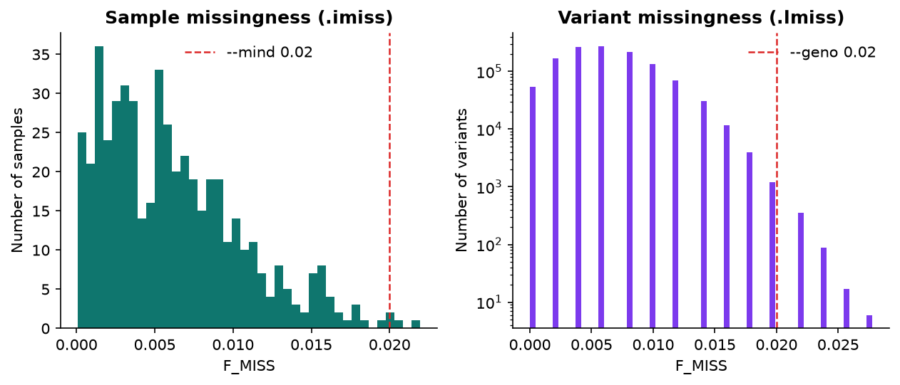
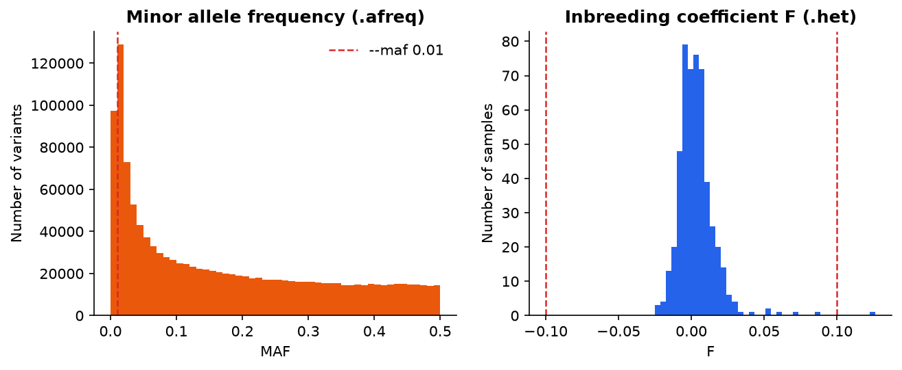
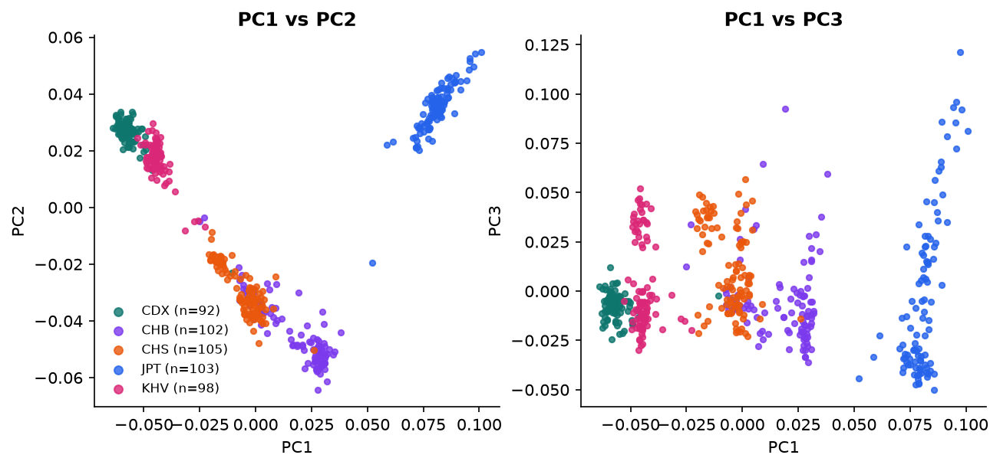
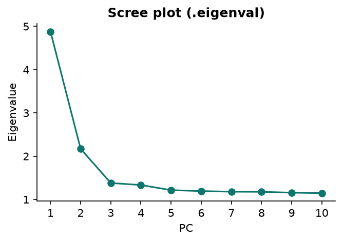
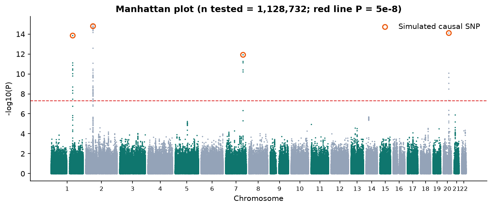
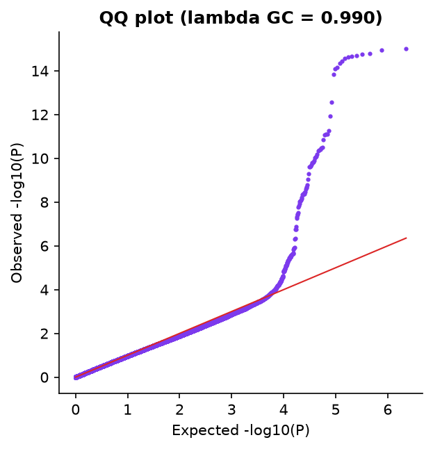
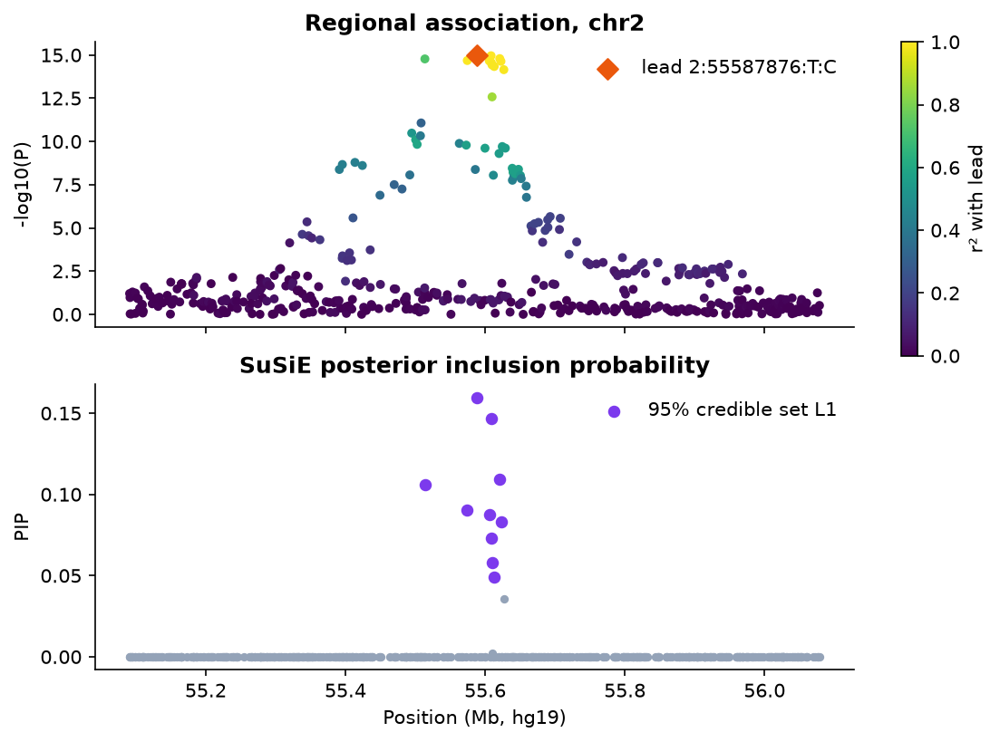

# 實跑結果

這一頁放本課程**實際執行** GWASTutorial 流程得到的圖與表，讓你在自己動手前先知道「做對了大概長什麼樣子」，做完後也能逐項對照。

## 怎麼產生的

- **流程**：repo 裡的 [`analysis/run_gwas.sh`](https://github.com/greengarden0925/VibeCoding-GWAS/blob/main/analysis/run_gwas.sh)，指令照抄 [GWASTutorial](https://cloufield.github.io/GWASTutorial/) 的 QC、PCA、關聯分析、clumping 頁面，只改了輸入與輸出路徑。
- **畫圖與整理表格**：[`analysis/make_figures.py`](https://github.com/greengarden0925/VibeCoding-GWAS/blob/main/analysis/make_figures.py)。
- **精細定位**：[`analysis/finemap.R`](https://github.com/greengarden0925/VibeCoding-GWAS/blob/main/analysis/finemap.R)，用 susieR 的 `susie_rss()`。
- **執行環境**：GitHub Actions 的 Ubuntu 機器，流程檔是 [`.github/workflows/gwas-analysis.yml`](https://github.com/greengarden0925/VibeCoding-GWAS/blob/main/.github/workflows/gwas-analysis.yml)。

- **本頁數字出自**：2026-11-19 的 [GitHub Actions 執行紀錄 44460311879](https://github.com/greengarden0925/VibeCoding-GWAS/actions/runs/44460311879)。軟體版本：PLINK v1.9.1（2026-11-11 版）、PLINK v2.0.0-b.1.4LM（2026-11-07 版）、susieR 0.14.2。
- **原始輸出**：每一步的 PLINK `.log`、表格與 `summary.json` 都放在 repo 的 [`analysis-results` 分支](https://github.com/greengarden0925/VibeCoding-GWAS/tree/analysis-results)，本頁每個數字都能在那裡找到。

## 和 GWASTutorial 對照

GWASTutorial 的數字取自其[關聯分析頁](https://cloufield.github.io/GWASTutorial/06_Association_tests/)與 clumping 頁的執行紀錄。

| 項目 | GWASTutorial 公布 | 本課程實跑 | 一致？ |
|---|---|---|---|
| 原始資料 | 504 人、1,235,116 個變異 | 504 人、1,235,116 個變異 | 一致 |
| QC 後的 `sample_data.clean` | 500 人、1,224,104 個變異 | 500 人、**1,128,732** 個變異 | 樣本一致，變異數不同 |
| 關聯分析的病例／對照 | 248／250 | 248／250 | 一致 |
| 關聯分析實際檢定的變異數 | 1,128,732（經 `--maf 0.01` 後） | 1,128,732 | 一致 |
| `FIRTH_CONVERGE_FAIL` | 有出現 | **0 個**（所有變異的 ERRCODE 都是 `.`） | 不同 |
| Clumping | 40 clumps，來自 307 個 top variants | **26 clumps，來自 165 個 top variants** | 不同 |
| `2:55513738:C:T` 的 P 值 | 1.69×10⁻¹⁵（第一個 clump 的中心） | 1.687×10⁻¹⁵（但不再是最顯著） | P 值一致 |
| 第 2 號染色體最顯著的 SNP | `2:55513738:C:T` | `2:55587876:T:C`（P = 9.833×10⁻¹⁶） | 不同 |

!!! question "為什麼有些數字不同？"
    兩邊用的是同一份資料和同一組指令，差別在 **PLINK 版本**：我們用的是 2026 年 11 月的版本。以下是從 log 確認到的事實，原因沒有逐一驗證：

    - 我們的 PLINK 1.9 在產出 `sample_data.clean` 時，log 記錄「95372 variants removed due to minor allele threshold(s)」，所以 QC 後就只剩 1,128,732 個；GWASTutorial 的紀錄則是到關聯分析才用 `--maf 0.01` 篩到同一個數字。最後進入關聯分析的變異數兩邊相同。
    - 新版 PLINK 2 在計算 PCA 時，若有變異的 MAF 低於 0.25/√樣本數，會直接報錯停止（見下方 PCA 一節）。GWASTutorial 撰寫時沒有這個檢查。
    - Firth 收斂失敗、clump 數與最顯著 SNP 的差異，可能也和版本有關，本課程沒有進一步驗證。

    **這正是 L04 要你記錄軟體版本的原因。** 課堂上可以讓學生拿這張表問 Claude：「請讀 analysis-results 分支的 log，找出兩邊差在哪一步。」

## QC（L07）

| 步驟 | 樣本數 | 變異數 |
|---|---|---|
| 原始資料 | 504 | 1235116 |
| F 絕對值 > 0.1 的樣本（移除） | 1 | — |
| LD 修剪後保留的 SNP（供 het／PCA 用） | — | 232105 |
| QC 後（sample_data.clean） | 500 | 1128732 |

<figure markdown="span">
  { width="100%" }
  <figcaption>左：每個樣本的缺失率（.imiss）；右：每個變異的缺失率（.lmiss，y 軸為對數）。紅線是 --mind 0.02 與 --geno 0.02。本課程實跑。</figcaption>
</figure>

<figure markdown="span">
  { width="100%" }
  <figcaption>左：MAF 分布，紅線是 --maf 0.01；右：近交係數 F，紅線是 ±0.1。只有 1 個樣本的 F 超過 0.1（最大值 0.1265）。本課程實跑。</figcaption>
</figure>

從 `sample_data.clean.log`：`--remove` 移除 F 超標的 1 人後剩 503 人，`--mind` 再移除 3 人，最後 500 人；變異方面 `--geno` 移除 375 個、`--hwe` 移除 10,637 個、MAF 門檻移除 95,372 個。

## PCA（L08）

<figure markdown="span">
  { width="100%" }
  <figcaption>投影後的 PC1 對 PC2、PC1 對 PC3，依 1000 Genomes 族群代碼上色：CDX 92、CHB 102、CHS 105、JPT 103、KHV 98 人。本課程實跑。</figcaption>
</figure>

<figure markdown="span">
  { width="60%" }
  <figcaption>前 10 個主成分的特徵值，PC1 = 4.879、PC2 = 2.168，之後都在 1.1 到 1.4 之間。本課程實跑。</figcaption>
</figure>

- LD 修剪後保留 196,752 個 SNP 用於親緣與 PCA。
- `--king-cutoff 0.0884` 排除 **0 人**，500 人全部保留。
- JPT（日本東京）在 PC1、PC2 上和其他族群明顯分開；南方的 CDX、KHV 與北方的 CHB 位在另一端，CHS 在中間。

!!! warning "新版 PLINK 2 的 PCA 會報錯"
    照 GWASTutorial 原指令執行 `--pca approx allele-wts 10`，2026 年版的 PLINK 2 會停下來並回報 MAF 最低為 0.01，低於 0.0111803（0.25/√500）。PLINK 2 的說明文字指出，PCA 會用 sqrt(2p(1-p)) 標準化每個變異，p 接近 0 時一個罕見變異就可能主導結果，所以新版改成直接報錯。我們加上 `--grm-maf 0.01 yes-really` 來重現原教學的設定。上課時這是很好的例子：**錯誤訊息先請 Claude 解釋原因，再決定怎麼改。**

## 關聯分析（L09）

<figure markdown="span">
  { width="100%" }
  <figcaption>1,128,732 個變異的 Manhattan plot，紅線是 P = 5×10⁻⁸，橘色圈是模擬致病 SNP。P &lt; 5×10⁻⁸ 的變異共 63 個。本課程實跑。</figcaption>
</figure>

<figure markdown="span">
  { width="55%" }
  <figcaption>QQ plot，λGC = 0.990。大部分點貼著對角線，尾端上揚來自真正的關聯訊號。本課程實跑。</figcaption>
</figure>

**P 值最小的 10 個變異**（全部在第 2 號染色體）：

| CHROM | POS | ID | REF | ALT | A1 | A1_FREQ | OR | LOG(OR)_SE | P |
|---|---|---|---|---|---|---|---|---|---|
| 2 | 55587876 | 2:55587876:T:C | T | C | C | 0.3139 | 0.261 | 0.1673 | 9.831e-16 |
| 2 | 55608492 | 2:55608492:G:C | G | C | G | 0.3129 | 0.2621 | 0.1671 | 1.103e-15 |
| 2 | 55620927 | 2:55620927:G:A | G | A | G | 0.3139 | 0.2649 | 0.1667 | 1.62e-15 |
| 2 | 55513738 | 2:55513738:C:T | C | T | C | 0.376 | 0.2954 | 0.1532 | 1.687e-15 |
| 2 | 55574452 | 2:55574452:G:C | G | C | C | 0.3119 | 0.2652 | 0.1673 | 2.085e-15 |
| 2 | 55605943 | 2:55605943:A:G | A | G | A | 0.3145 | 0.2666 | 0.1667 | 2.175e-15 |
| 2 | 55622624 | 2:55622624:G:A | G | A | G | 0.3115 | 0.266 | 0.1671 | 2.315e-15 |
| 2 | 55608866 | 2:55608866:A:T | A | T | A | 0.3143 | 0.2709 | 0.1653 | 2.763e-15 |
| 2 | 55609851 | 2:55609851:C:T | C | T | C | 0.3149 | 0.2728 | 0.1652 | 3.74e-15 |
| 2 | 55612986 | 2:55612986:G:C | G | C | G | 0.3148 | 0.272 | 0.1662 | 4.617e-15 |

**5 個模擬致病 SNP 的結果：**

| CHR | POS | ID | A1 | A1_FREQ | OR | P | ERRCODE |
|---|---|---|---|---|---|---|---|
| 1 | 167562605 | 1:167562605:G:A | A | 0.3915 | 3.416 | 1.419e-14 | . |
| 2 | 55620927 | 2:55620927:G:A | G | 0.3139 | 0.2649 | 1.62e-15 | . |
| 7 | 134326056 | 7:134326056:G:T | T | 0.1348 | 5.198 | 1.211e-12 | . |
| 20 | 42758834 | 20:42758834:T:C | T | 0.2273 | 0.2388 | 7.907e-15 | . |

`8:97094292:C:T` 不在 GWAS 結果裡。查它在原始資料的 QC 指標：

| ID | ALT_FREQS | MAF | F_MISS | HWE_P | 通過 QC |
|---|---|---|---|---|---|
| 2:55620927:G:A | 0.6869 | 0.3131 | 0.001984 | 0.6791 | 是 |
| 8:97094292:C:T | 0.001992 | 0.001992 | 0.003968 | 1 | 否 |
| 20:42758834:T:C | 0.7745 | 0.2255 | 0.005952 | 0.306 | 是 |
| 7:134326056:G:T | 0.1352 | 0.1352 | 0.001984 | 0.7045 | 是 |
| 1:167562605:G:A | 0.3908 | 0.3908 | 0.009921 | 0.1892 | 是 |

它的 MAF 只有 0.002，被 `--maf 0.01` 排除了。**模擬的 5 個致病 SNP 中，只有 4 個有機會被 GWAS 找到。**

## Clumping（L10）

PLINK log：「26 clumps formed from 165 top variants」。其中中心 SNP 達全基因體顯著（P &lt; 5×10⁻⁸）的有 4 個：

| CHR | SNP | BP | P | TOTAL |
|---|---|---|---|---|
| 2 | 2:55587876:T:C | 55587876 | 9.83e-16 | 74 |
| 20 | 20:42758834:T:C | 42758834 | 7.91e-15 | 34 |
| 1 | 1:167562605:G:A | 167562605 | 1.42e-14 | 20 |
| 7 | 7:134326056:G:T | 134326056 | 1.21e-12 | 20 |

4 個顯著位點正好對應 4 個通過 QC 的致病 SNP。第 20、1、7 號染色體的中心 SNP 就是致病 SNP 本身；第 2 號染色體的中心 SNP 是 `2:55587876:T:C`，致病 SNP `2:55620927:G:A` 排第三（P = 1.62×10⁻¹⁵），兩者相距約 33 kb。

## 精細定位（L12）

對第 2 號染色體的位點（中心 SNP 前後 500 kb，共 468 個 SNP）跑 SuSiE（`susie_rss`，L = 10，n 取 OBS_CT 的中位數）。LD 矩陣用 QC 後的 500 人以 `plink --r square` 計算。

<figure markdown="span">
  { width="100%" }
  <figcaption>上：區域關聯圖，顏色是和中心 SNP 的 r²；下：SuSiE 的後驗納入機率（PIP），紫色點屬於 95% 可信集合。本課程實跑。</figcaption>
</figure>

SuSiE 找到 **1 個 95% 可信集合，含 10 個 SNP**（purity：最小絕對相關 0.849）：

| CS | ID | POS | P | PIP | r2 |
|---|---|---|---|---|---|
| 1 | 2:55587876:T:C | 55587876 | 9.831e-16 | 0.1598 | 1 |
| 1 | 2:55608492:G:C | 55608492 | 1.103e-15 | 0.1464 | 1 |
| 1 | 2:55620927:G:A | 55620927 | 1.62e-15 | 0.1093 | 1 |
| 1 | 2:55513738:C:T | 55513738 | 1.687e-15 | 0.106 | 0.7242 |
| 1 | 2:55574452:G:C | 55574452 | 2.085e-15 | 0.0902 | 0.9952 |
| 1 | 2:55605943:A:G | 55605943 | 2.175e-15 | 0.08735 | 1 |
| 1 | 2:55622624:G:A | 55622624 | 2.315e-15 | 0.08329 | 1 |
| 1 | 2:55608866:A:T | 55608866 | 2.763e-15 | 0.0728 | 0.9953 |
| 1 | 2:55609851:C:T | 55609851 | 3.74e-15 | 0.05774 | 0.9905 |
| 1 | 2:55612986:G:C | 55612986 | 4.617e-15 | 0.04914 | 0.9904 |

致病 SNP `2:55620927:G:A` 在可信集合裡，但 PIP 只有 0.109，排第三。這 10 個 SNP 彼此高度連鎖，500 人的資料不足以分辨誰才是致病變異。這也說明：**可信集合縮小了候選範圍，但不保證最高 PIP 的就是致病 SNP。**
