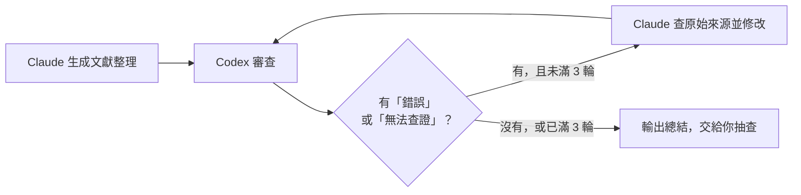

# 用終端機操作 Claude Code：基本設定、記憶、指令與多工協作

前面的章節都在 VS Code 面板裡操作 Claude Code。這一章改成在**終端機（terminal）**裡直接打 `claude`。終端機版功能最完整：所有 `/` 指令、快速鍵、多視窗並行、手機遙控、Codex 協作都從這裡開始。

!!! info "本章資料來源"
    指令、快速鍵與設定取自 Claude Code 官方文件（2026-11-26 擷取）：[Commands](https://code.claude.com/docs/en/commands)、[Interactive mode](https://code.claude.com/docs/en/interactive-mode)、[CLI reference](https://code.claude.com/docs/en/cli-reference)、[Memory](https://code.claude.com/docs/en/memory)、[Hooks guide](https://code.claude.com/docs/en/hooks-guide)、[Remote Control](https://code.claude.com/docs/en/remote-control)、[Voice dictation](https://code.claude.com/docs/en/voice-dictation)；Codex 部分取自 [openai/codex-plugin-cc](https://github.com/openai/codex-plugin-cc)（v1.0.6）。撰寫時使用 Claude Code 2.1.332。Claude Code 更新很快，指令名稱若對不上，在 Claude Code 裡打 `/help` 或 `/` 看目前版本的清單，以官方頁面為準。

**本章學習目標**

- [ ] 會在終端機啟動、接續、命名 Claude Code 對話
- [ ] 分得清 CLAUDE.md、auto memory、hook 各自做什麼，知道什麼時候用哪一個
- [ ] 會用常用的 `/` 指令和快速鍵
- [ ] 知道什麼時候該壓縮對話，以及怎麼讓下一個 agent 接手
- [ ] 會找 skill，並在安裝前檢查它安不安全
- [ ] 讓 Claude Code 和 Codex 一起完成一個小任務
- [ ] 用手機遙控本機的 Claude Code，同時開多個 Claude Code 分工

---

## 一、在終端機啟動 Claude Code

### 1.1 安裝與第一次啟動

如果 L02 已經裝好命令列版，可以跳過安裝。

=== "Windows（PowerShell）"

    ```powershell
    irm https://claude.ai/install.ps1 | iex
    ```

=== "macOS / Linux"

    ```bash
    curl -fsSL https://claude.ai/install.sh | bash
    ```

裝好後，**先切到專案資料夾，再啟動**。Claude Code 只看得到啟動位置以下的檔案，記憶與對話紀錄也跟著資料夾走。

```bash
cd D:\vibegwas        # Windows 範例；Mac 例如 cd ~/vibegwas
claude                # 啟動互動模式
```

第一次啟動會打開瀏覽器要你登入。確認版本與健康狀態：

```bash
claude --version      # 看版本
claude doctor         # 或在 Claude Code 裡打 /doctor，檢查安裝與設定問題
```

### 1.2 常用啟動參數

| 指令 | 用途 |
|---|---|
| `claude` | 開新對話 |
| `claude "幫我看這個資料夾在做什麼"` | 開新對話並直接送出第一句 |
| `claude -c`（`--continue`） | 接續**這個資料夾**最近一次的對話 |
| `claude -r`（`--resume`） | 打開對話清單挑一個接續；`claude -r gwas-qc` 直接接續名為 gwas-qc 的對話 |
| `claude -n "gwas-qc"`（`--name`） | 開新對話並命名，之後好找 |
| `claude -p "列出這個資料夾的 R 檔"`（`--print`） | 不進互動模式，印出答案就結束，可接在腳本裡 |
| `claude --model sonnet` | 指定模型（`opus`、`sonnet`、`haiku`、`fable` 或完整模型名稱） |
| `claude --permission-mode plan` | 用「只規劃、不動手」模式啟動 |
| `claude -w qc-branch`（`--worktree`） | 在獨立的 git worktree 裡啟動，多工時用（見第十節） |

### 1.3 認識畫面

```text
╭──────────────────────────────────────────────╮
│ ✻ Welcome to Claude Code                      │   ← 歡迎訊息、目前資料夾
╰──────────────────────────────────────────────╯
 > 請幫我讀 data/sample.csv，告訴我有幾欄       ← 提示框：在這裡打字
 ? for shortcuts            ⏵⏵ accept edits on   ← 下方：權限模式、提示
 Opus 5.5 · 23% context · main                   ← 狀態列（可自訂，見 /statusline）
```

輸入框開頭的符號有特殊意義：

| 開頭 | 意義 | 例子 |
|---|---|---|
| `/` | 指令或 skill | `/clear`、`/model` |
| `!` | 直接執行 shell 指令，輸出會進到對話裡給 Claude 看 | `! git status` |
| `@` | 引用檔案（有自動完成） | `@analysis/qc.R 這支腳本在做什麼？` |
| `?` | 在空白輸入框打，顯示快速鍵說明 | |

---

## 二、CLAUDE.md、記憶（memory）與 hook

這三個東西都在「讓 Claude 不用每次重講」，但分工不同：

| | CLAUDE.md | Auto memory | Hook |
|---|---|---|---|
| 是什麼 | 你寫給 Claude 的**說明書** | Claude 自己記下的**筆記** | 在特定時機**一定會執行**的指令 |
| 誰寫 | 你（或 `/init` 起草，你修改） | Claude 自動寫，你可以檢查、刪除 | 你寫在 settings.json |
| 何時生效 | 每次啟動時讀進來 | 每次啟動時讀索引 `MEMORY.md` | 事件發生時由程式執行，不靠 Claude 記得 |
| 適合放 | 專案規則、資料夾結構、常用指令、寫程式慣例 | 你糾正過它的事、你的偏好、專案進度 | 「每次都要」的事：格式化、通知、擋危險指令 |
| 保證程度 | 高，但 Claude 仍可能沒照做 | 中，由 Claude 判斷要不要用 | **100%**，程式執行，不是建議 |

!!! tip "判斷口訣"
    - 「Claude 應該**知道**的事」寫 CLAUDE.md。
    - 「Claude 自己學到、以後還用得到的事」交給 memory。
    - 「**每次都必須發生**、不能靠它記得的事」用 hook。

### 2.1 CLAUDE.md

**放在哪裡、誰會讀到**（由大到小，後讀的較具體）：

| 位置 | 範圍 | 要不要進 git |
|---|---|---|
| `~/.claude/CLAUDE.md` | 你自己的所有專案 | 不用 |
| `專案/CLAUDE.md` 或 `專案/.claude/CLAUDE.md` | 這個專案，全組共用 | **要** |
| `專案/CLAUDE.local.md` | 這個專案，只有你自己 | 不要（加進 `.gitignore`） |
| `專案/子資料夾/CLAUDE.md` | Claude 進到該子資料夾工作時才讀 | 要 |
| `專案/.claude/rules/*.md` | 拆成多個主題規則；可用 `paths:` 指定只對某些檔案生效 | 要 |

**怎麼建立**：在專案資料夾打 `/init`，Claude 會掃描專案、起草一份 CLAUDE.md。**一定要自己讀過、刪改**，它寫的是草稿。之後用 `/memory` 可以打開編輯。

**GWAS 專案的 CLAUDE.md 範例**：

```markdown
# VibeCoding-GWAS 專案說明

## 資料夾
- data/raw/：原始資料，**唯讀，不准修改或刪除**
- data/processed/：清理後的資料
- analysis/：R 與 Python 腳本，依步驟編號 01_qc.R、02_pca.R ...
- results/：圖表與表格輸出

## 規則
- 統計分析用 R（tidyverse），流程控制用 Python 3.11
- 所有腳本開頭註明：輸入檔、輸出檔、作者、日期
- QC 門檻：MAF < 0.01、HWE p < 1e-6、call rate < 0.95 剔除
- 圖檔一律輸出 PNG 300 dpi 與 PDF 各一份

## 常用指令
- 跑 QC：Rscript analysis/01_qc.R
- 跑測試：pytest tests/

## 交接
- 開始工作前先讀 PROGRESS.md，結束前更新它（見第六節）

更多背景見 @README.md
```

!!! warning "寫 CLAUDE.md 的原則"
    - **短**：官方建議每個檔案 200 行以內。太長 Claude 反而抓不到重點，也吃掉 context。
    - **具體**：「QC 門檻 MAF < 0.01」比「注意資料品質」有用。
    - **用 `@路徑` 引用**其他檔案，不要整份貼進來。
    - 不要放密碼、API key。

### 2.2 Auto memory（自動記憶）

Claude 在對話中學到值得保留的事（例如你說「以後圖都用 300 dpi」），會自己寫到：

```text
~/.claude/projects/<專案名稱>/memory/
├── MEMORY.md          ← 索引，每次啟動讀前 200 行
├── user-pref-dpi.md   ← 一個檔案一件事
└── ...
```

- 打 `/memory` 可以看它記了什麼、開關 auto memory。
- 想讓它記住某件事，直接說：「**記住**：我們的 HWE 門檻是 1e-6。」
- 記錯了就說「把關於 XX 的記憶刪掉」，或自己刪檔案。
- 這是存在**你電腦**裡的個人筆記，不會進 git；要讓組員也知道的規則請寫 CLAUDE.md。

### 2.3 Hook

Hook 是「在某個時機自動執行一段指令」。常用的時機（事件）：

| 事件 | 何時觸發 | 常見用途 |
|---|---|---|
| `SessionStart` | 啟動或接續對話時 | 自動把 PROGRESS.md 內容餵給 Claude |
| `UserPromptSubmit` | 你送出訊息時 | 附加提醒、記錄 |
| `PreToolUse` | Claude 要用工具**之前** | 擋掉危險指令（例如刪除 `data/raw/`） |
| `PostToolUse` | Claude 用完工具之後 | 改完檔案後自動格式化 |
| `Notification` | Claude 需要你回應時 | 跳出桌面通知 |
| `Stop` | Claude 回答完一輪時 | 提醒、自動檢查 |
| `PreCompact` | 壓縮對話之前 | 先把進度存檔 |

**設定方式**：寫在 settings.json 的 `"hooks"` 裡。設定檔位置：

| 檔案 | 範圍 |
|---|---|
| `~/.claude/settings.json` | 你所有專案 |
| `專案/.claude/settings.json` | 這個專案，全組共用（進 git） |
| `專案/.claude/settings.local.json` | 這個專案，只有你（不進 git） |

**範例一：Claude 等你回應時跳通知（Windows）**

```json
{
  "hooks": {
    "Notification": [
      {
        "matcher": "",
        "hooks": [
          {
            "type": "command",
            "command": "powershell -NoProfile -Command \"[console]::beep(800,300); Add-Type -AssemblyName System.Windows.Forms; [System.Windows.Forms.MessageBox]::Show('Claude Code 在等你回應')\""
          }
        ]
      }
    ]
  }
}
```

macOS 可改成 `osascript -e 'display notification "Claude Code 在等你" with title "Claude Code"'`。

**範例二：每次開對話自動讀交接檔**

```json
{
  "hooks": {
    "SessionStart": [
      {
        "matcher": "",
        "hooks": [
          { "type": "command", "command": "cat PROGRESS.md 2>/dev/null || echo 'no PROGRESS.md'" }
        ]
      }
    ]
  }
}
```

`SessionStart` hook 印出的文字會變成 Claude 看得到的背景資訊。

!!! tip "不想手寫 JSON？"
    直接跟 Claude 說：「幫我加一個 hook：每次 Claude 等我回應時跳 Windows 通知。」它會幫你改 settings.json。改完打 `/hooks` 確認設定有被讀到。
    
    Hook 會用你的帳號權限執行任何指令。**別人給的 hook 設定，看懂再貼。**

---

## 三、常用 `/` 指令

在提示框打 `/`，會跳出清單，繼續打字可以篩選。以下是本課程常用的指令。

### 3.1 帳號與專案

| 指令 | 用途 | 何時用 |
|---|---|---|
| `/login` | 登入 Anthropic 帳號 | 第一次使用、換帳號、登入過期 |
| `/logout` | 登出 | 用公用電腦、要換帳號前 |
| `/init` | 掃描專案，起草 CLAUDE.md | 新專案第一次打開時 |
| `/memory` | 編輯 CLAUDE.md、查看與開關 auto memory | 想調整規則或檢查它記了什麼 |
| `/config` | 打開設定（主題、預設模型、自動壓縮等） | 調整偏好 |
| `/doctor` | 檢查安裝與設定問題 | 怪怪的時候先跑這個 |

### 3.2 對話管理

| 指令 | 用途 | 何時用 |
|---|---|---|
| `/clear` | 清空對話，重新開始（別名 `/new`、`/reset`） | **換新任務時**。舊任務的內容會干擾新任務 |
| `/rename gwas-qc` | 幫目前對話取名，顯示在提示框上；不給名字會自動取 | 同時開多個對話、之後要 `/resume` 時好找 |
| `/recap` | 用一句話摘要目前對話在做什麼 | 離開一陣子回來，或切換視窗時 |
| `/resume` | 挑一個舊對話接續（別名 `/continue`） | 昨天沒做完 |
| `/compact` | 壓縮對話（見第五節） | context 快滿時 |
| `/context` | 用色塊顯示 context 用了多少、被什麼吃掉 | 想知道為什麼變慢、變笨 |
| `/rewind` | 倒回某個時間點，可以連程式碼一起還原（別名 `/undo`） | Claude 改壞了 |
| `/btw 問題` | 問個旁支問題，不寫進對話紀錄 | 臨時想問「這個參數是什麼意思」 |
| `/export` | 把對話匯出成文字檔 | 要交作業或留紀錄 |

### 3.3 模型、權限與用量

| 指令 | 用途 | 何時用 |
|---|---|---|
| `/model` | 切換模型；不帶參數會跳出選單 | 簡單任務用 Sonnet / Haiku 省額度，難題用 Opus |
| `/effort` | 調整思考深度 | 難題調高，簡單工作調低 |
| `/permissions` | 管理允許、詢問、拒絕的規則 | 一直被問同樣的權限、或想禁止某些動作 |
| `/usage` | 看本次花費、方案額度、使用統計（別名 `/cost`） | 擔心額度用完 |
| `/stats` | 同 `/usage`，直接打開統計分頁 | 看自己這週用了多少 |
| `/statusline` | 自訂畫面最下方的狀態列 | 想一直看到模型、context 百分比、git 分支 |
| `/voice` | 開關語音輸入 | 不想打字時 |

**`/permissions` 補充：權限模式**

按 ++shift+tab++ 可以循環切換權限模式，畫面下方會顯示目前模式：

| 模式 | 行為 | 適合 |
|---|---|---|
| 預設（Manual） | 改檔、執行指令都先問你 | 剛開始、重要資料 |
| Accept edits | 改檔不問，執行指令仍會問 | 你信任它改程式 |
| Plan | 只讀、只規劃，不改任何東西 | 動手前先討論做法 |
| Auto | 由分類器判斷安全的動作自動放行 | 熟練後、有 git 備份時 |

也可以把規則寫進 settings.json，讓常用指令不再詢問、讓敏感檔案永遠不能讀：

```json
{
  "permissions": {
    "allow": ["Bash(Rscript:*)", "Bash(python:*)", "Bash(git status)"],
    "deny":  ["Read(./.env)", "Bash(rm -rf:*)", "Edit(./data/raw/**)"]
  }
}
```

**`/statusline` 補充**

直接用文字描述你要什麼：

```text
/statusline 顯示模型名稱、context 使用百分比、目前 git 分支
```

Claude 會幫你寫一支小腳本並設定好。

**`/voice` 補充**

`/voice` 開啟後，**按住**指定鍵說話、放開送出（`/voice hold`），或**按一下**開始、再按一下送出（`/voice tap`）；`/voice off` 關閉。需要用 claude.ai 帳號登入，SSH 遠端與雲端對話不能用。說中文也可以，送出前記得看一下辨識結果，專有名詞（例如 rs 編號、基因名稱）容易聽錯。

---

## 四、常用快速鍵

按 `?`（空白輸入框時）可以隨時叫出說明。

### 4.1 最常用的 10 個

| 按鍵 | 作用 |
|---|---|
| ++esc++ | **中斷** Claude 正在做的事（不會關掉 Claude Code）。它走錯方向時立刻按 |
| ++esc++ ++esc++ | 輸入框有字時清空；輸入框空白時打開 **rewind** 選單，回到之前的時間點 |
| ++shift+tab++ | 切換權限模式（Manual → Accept edits → Plan → Auto） |
| ++ctrl+c++ | 中斷；沒在執行時按一次清空輸入，再按一次離開 |
| ++shift+enter++ | 換行不送出（Windows Terminal 1.25 以上可用；不行就打 `\` 再按 ++enter++） |
| ++up++ / ++down++ | 翻之前輸入過的訊息 |
| ++ctrl+r++ | 搜尋輸入紀錄 |
| ++ctrl+o++ | 打開詳細紀錄，看 Claude 每一步用了什麼工具 |
| ++ctrl+b++ | 把正在跑的長指令丟到背景，你可以繼續對話 |
| ++ctrl+t++ | 顯示或隱藏 Claude 的待辦清單 |

### 4.2 進階

| 按鍵 | 作用 |
|---|---|
| ++ctrl+g++ | 用文字編輯器寫長提示詞（例如貼一大段分析需求） |
| ++ctrl+s++ | 暫存目前輸入，先處理別的事；空白時按會取回 |
| ++ctrl+v++（Windows 也可 ++alt+v++） | 貼上圖片（截圖給它看錯誤畫面、圖表） |
| ++alt+p++ | 快速切換模型 |
| ++alt+t++ | 開關延伸思考 |
| ++tab++ | 接受自動完成 |
| ++ctrl+l++ | 重畫畫面 |
| ++ctrl+d++ 按兩次 | 離開 Claude Code |

!!! tip "Claude 在跑時也可以打字"
    Claude 還在工作時，你可以直接輸入下一句並送出，它會排隊，等這一輪結束後接著處理。想補充方向就這樣做，不用等。

想改快速鍵：打 `/keybindings`。

---

## 五、壓縮對話：`/compact` 與自動壓縮

### 5.1 為什麼重要

Claude 每次回答，都要把**整段對話**（你的訊息、它讀過的檔案、指令輸出）重新看一遍。這段可以看的長度叫 **context window**，有上限。

對話越長：

- **越慢、越耗額度**：每一輪都要重讀全部內容。
- **越容易出錯**：早期的錯誤嘗試、不相關的檔案會干擾判斷，它可能忘了一開始的規則。
- **滿了就得壓縮**：自動壓縮會在你沒準備時發生，可能丟掉你在意的細節。

壓縮（compact）是把舊對話**濃縮成一份摘要**，保留重點、丟掉細節，空出 context 繼續工作。

### 5.2 指令

| 指令 | 作用 |
|---|---|
| `/context` | 看 context 用了多少、哪些東西最佔空間 |
| `/compact` | 立刻壓縮 |
| `/compact 保留 QC 門檻與已完成的步驟，丟掉除錯過程` | **帶指示**壓縮，告訴它要保留什麼 |
| `/autocompact` | 設定自動壓縮：`/autocompact auto` 由系統決定時機，`/autocompact 150000` 設定在多少 token 時壓縮；不帶參數會打開設定視窗 |
| `/clear` | 不壓縮，直接全部清掉重來 |

### 5.3 什麼時候用哪一個

| 情況 | 建議 |
|---|---|
| 做完一個任務，要開始**不相關**的新任務 | `/clear`（最乾淨） |
| 同一個任務做到一半，context 已超過一半 | `/compact 保留…`，在**段落結束處**主動壓縮 |
| 剛除錯完一大串，錯誤訊息塞滿對話 | `/compact 只保留最後的解法` |
| 正在改程式改到一半 | **先不要壓**，等這個段落做完再壓 |
| 任務很長、會跨好幾天 | 先寫交接檔（第六節），再 `/clear` 或 `/compact` |

!!! warning "壓縮前先存檔"
    壓縮後的摘要可能漏掉細節。重要的決定（門檻、檔名、做到哪一步）先請 Claude 寫進 PROGRESS.md 或 CLAUDE.md，再壓縮。檔案不會被壓縮掉。

---

## 六、做到一半中斷了，下次怎麼接？

額度用完、電腦當機、下課了，任務只做一半很常見。有三層方法，越下面越可靠。

### 6.1 第一層：接續原本的對話

```bash
claude -c                 # 接續這個資料夾最近一次的對話
claude -r                 # 打開清單挑一個
claude -r gwas-qc         # 接續名為 gwas-qc 的對話（要先用 /rename 或 -n 命名）
```

在 Claude Code 裡面則用 `/resume`（也可以打 `/continue`）。接回來後打 `/recap` 讓它一句話說明做到哪。

**缺點**：對話很長時接回來會吃滿 context；換一台電腦或換別的 agent（例如 Codex）就接不到。

### 6.2 第二層：交接檔 PROGRESS.md

讓進度**存在檔案裡**，任何 agent、任何時候都讀得到。在 CLAUDE.md 加一段規則：

```markdown
## 交接規則
- 開始工作前，先讀 PROGRESS.md。
- 每完成一個步驟，或我說「先到這裡」時，更新 PROGRESS.md。
```

PROGRESS.md 範例：

```markdown
# 進度（最後更新：2026-11-26 15:40）

## 目標
完成 GWASTutorial 1000 Genomes EAS 練習資料（504 人）的 QC 與 PCA

## 已完成
- [x] 01_qc.R：MAF、HWE、call rate 篩選，輸出 data/processed/qc_pass.snplist（剩餘 SNP 數見 results/qc/qc.log）
- [x] 單元測試 tests/test_qc.py 全過

## 進行中
- [ ] 02_pca.R：已寫好，**還沒跑**，跑之前要先確認 plink 路徑

## 已知問題
- chr X 尚未處理，先排除

## 下一步
1. 跑 Rscript analysis/02_pca.R
2. 畫 PC1 vs PC2 散布圖到 results/
```

準備離開時，對 Claude 說：

```text
先到這裡。請更新 PROGRESS.md：寫清楚已完成、進行中、遇到的問題與下一步，讓下一個 agent 不用看對話就能接手。
```

下次開新對話，第一句：

```text
讀 PROGRESS.md，從「下一步」第 1 項繼續。
```

### 6.3 第三層：自動化

- **SessionStart hook**（見 2.3 範例二）：每次開對話自動把 PROGRESS.md 餵給 Claude，你連提醒都不用。
- **PreCompact hook**：壓縮前自動提醒它更新進度。
- **auto memory**：跟它說「記住：這個專案的進度都記在 PROGRESS.md」，它之後會主動去讀。
- **git commit**：每完成一步就 commit。程式碼的狀態最可靠的紀錄是 git。

!!! tip "什麼時候用哪一層"
    - 隔幾小時、同一台電腦 → `claude -c` 就夠。
    - 隔天、換電腦、換 agent、對話已經很長 → PROGRESS.md + `/clear` 開新對話。
    - 長期專案 → 三層都用。

---

## 七、找 skill 與檢查安全性

**Skill** 是一包「教 Claude 做某件事的說明書與工具」，例如做簡報、寫論文、畫圖。裝了之後，Claude 遇到相關任務會自動使用，也可以用 `/skill名稱` 手動叫用。

### 7.1 找 skill

**方法一：問 Claude（需已安裝 find-skills skill）**

```text
有沒有 skill 可以幫我畫 Manhattan plot 和 QQ plot？
```

find-skills 會用 Skills CLI 去搜尋。

**方法二：自己用 Skills CLI**

```bash
npx skills find gwas          # 用關鍵字搜尋
npx skills find "manhattan plot"
npx skills add <作者>/<repo>   # 安裝
npx skills check              # 檢查已安裝 skill 有沒有更新
```

也可以到 <https://skills.sh/> 瀏覽排行榜。

**方法三：官方與外掛市集**

```text
/plugin                       # 打開外掛選單，瀏覽、安裝 plugin（plugin 裡常包含 skill）
```

裝好或修改 skill 後，打 `/reload-skills` 重新載入。

### 7.2 安裝前檢查安全性

Skill 可以叫 Claude 執行指令、讀寫檔案、連網路。**來路不明的 skill 等於讓陌生人在你電腦上下指令。** 安裝前做三件事：

**第一步：用 skill-vetter 掃描**

```text
用 skill-vetter 檢查這個 skill 能不能裝：https://github.com/某人/某skill
```

它會檢查權限範圍、可疑指令、提示詞注入（prompt injection）等紅旗，給出建議。

**第二步：自己看 SKILL.md 與附帶腳本**

先下載到一個**空的暫存資料夾**，不要直接裝：

```bash
git clone https://github.com/某人/某skill  D:\temp\skill-check
```

檢查清單：

- [ ] 作者是誰？有沒有其他人在用（star 數、issue、最近更新）？
- [ ] SKILL.md 的說明跟它實際做的事一致嗎？
- [ ] 有沒有要求讀取 `~/.ssh`、`.env`、瀏覽器資料、API key？
- [ ] 有沒有把資料傳到不明網址（`curl`、`wget`、`fetch`、`requests.post`）？
- [ ] 有沒有 `rm -rf`、修改系統設定、關閉安全檢查的指令？
- [ ] 有沒有藏起來的指令（base64 編碼、`eval`、「忽略之前的指示」之類的文字）？

可以用搜尋快速找紅旗：

```bash
grep -rnE "curl|wget|base64|eval|\.ssh|\.env|api[_-]?key|rm -rf|ignore (all|previous)" D:\temp\skill-check
```

**第三步：先在測試專案試用**，確認行為正常再裝到正式專案或全域。

!!! danger "處理病人或研究資料時"
    含個資或未公開資料的專案，只裝官方或自己看過程式碼的 skill。任何會連外網的 skill 都要特別小心。

---

## 八、Claude Code 與 Codex 協作

**Codex** 是 OpenAI 的程式 agent。用不同公司的模型互相檢查，能抓到單一模型自己看不出來的盲點。OpenAI 官方出了一個 Claude Code 外掛，讓你在 Claude Code 裡直接叫 Codex。

### 8.1 安裝

需求：Node.js 18.18 以上、ChatGPT 帳號（免費版也可以）或 OpenAI API key。

在 Claude Code 裡依序輸入：

```text
/plugin marketplace add openai/codex-plugin-cc
/plugin install codex@openai-codex
/reload-plugins
/codex:setup
```

`/codex:setup` 會檢查 Codex 有沒有裝好。沒裝的話它會問要不要幫你裝，或自己裝：

```bash
npm install -g @openai/codex
```

還沒登入 Codex 的話，在 Claude Code 裡打：

```text
! codex login
```

### 8.2 Codex 指令

| 指令 | 作用 | 會不會改程式 |
|---|---|---|
| `/codex:review` | 請 Codex 審查目前的修改（或用 `--base main` 跟 main 分支比較） | 不會，唯讀 |
| `/codex:adversarial-review 重點` | 「找碴式」審查，質疑設計與假設，可指定要挑戰的方向 | 不會，唯讀 |
| `/codex:rescue 任務` | 把任務交給 Codex 做（查 bug、修錯、寫程式） | **會** |
| `/codex:status` | 看背景中的 Codex 工作進度 | — |
| `/codex:result` | 看做完的 Codex 工作結果 | — |
| `/codex:cancel` | 取消背景中的 Codex 工作 | — |
| `/codex:transfer` | 把目前 Claude Code 對話轉成 Codex 對話，印出 `codex resume <id>` 讓你在 Codex 繼續 | — |

審查與 rescue 都可以加 `--background` 丟到背景，用 `/codex:status`、`/codex:result` 查看。

!!! note "需要 git"
    `/codex:review` 審查的是 git 裡的修改，專案資料夾要先 `git init` 並至少 commit 一次。

### 8.3 範例一：請 Codex 用 GPT Image 模型畫圖

**目標**：用 GPT Image 模型生成一張 GWAS 分析流程示意圖。約 10 分鐘，不需要任何資料。

Codex 內建圖片生成功能 `$imagegen`，由 GPT Image 模型直接畫出點陣圖（PNG），**不是寫程式畫圖**。需要用 ChatGPT 帳號登入 Codex；能不能用、可以畫幾張依你的方案而定（免費版可能無法生圖），生圖也會消耗額度。

**步驟 1：建立空資料夾並啟動**

```bash
mkdir codex-lab
cd codex-lab
git init
claude
```

**步驟 2：把畫圖任務交給 Codex**

```text
/codex:rescue 使用 $imagegen（GPT Image 模型）生成一張圖，不要寫 Python、SVG 或任何程式來畫。
主題：GWAS 分析流程示意圖。
步驟由左到右：收集基因型與表現型 → 品質管制（QC）→ 族群結構分析（PCA）→ 關聯分析 → Manhattan plot 與 QQ plot → 結果解讀。
風格：扁平化科普插畫、白色背景、橫式 16:9、每一步配一個小圖示和繁體中文標籤。
把圖片存成目前資料夾的 gwas_flow.png。如果無法使用圖片生成功能，直接告訴我，不要改用程式畫。
```

如果透過外掛叫不出圖片生成，另開終端機執行 `codex`，把上面的內容（去掉 `/codex:rescue`）貼進去。

**步驟 3：打開圖檢查**

打開 `gwas_flow.png`，檢查：

- 步驟順序和箭頭方向對嗎？
- 中文字有沒有錯字、缺筆畫或亂碼？英文縮寫（QC、PCA、QQ）拼對了嗎？
- 示意用的 Manhattan plot、QQ plot 只是插畫，**不是真實分析結果**，不可以當成研究圖表使用。

**步驟 4：不滿意就請它改**

```text
/codex:rescue 使用 $imagegen 修改 gwas_flow.png：「品質管制（QC）」改用橘色強調，其他版面不變，另存成 gwas_flow_v2.png。
```

!!! tip "生成圖片和程式畫圖的差別"
    GPT Image 適合示意圖、海報、封面。研究結果的圖（Manhattan plot、QQ plot、PCA）一定要用程式從真實資料畫。生成的圖每次都會有些不同，改圖時要說清楚哪些地方不要動。

### 8.4 範例二（小教案）：GWAS 最新文獻整理，Codex 審查內容正確性

| 項目 | 內容 |
|---|---|
| 時間 | 約 30 分鐘 |
| 分工 | Claude 查文獻並整理，Codex 審查，你做最後確認 |
| 準備 | 能上網的 Claude Code、已完成 8.1 安裝 |
| 產出 | `gwas_review.md`（文獻整理表）、`review_check.md`（審查結果） |

**學習目標**：能用 AI 整理文獻，並且知道 **AI 寫的內容一定要查證**，特別是作者、年份、期刊、DOI 和數字。

**步驟 1：請 Claude 整理文獻（10 分鐘）**

把主題換成你自己有興趣的疾病或性狀。

```text
請上網搜尋最近一年「第二型糖尿病 GWAS」的研究論文，挑 5 篇，整理成 gwas_review.md。
每篇用表格列出：第一作者、年份、期刊、標題、PMID、DOI、樣本數、研究族群、主要發現（一句話）。
規則：只能寫你實際查到的內容；查不到的欄位寫「未查到」，不要猜；每篇附上來源網址。
```

**步驟 2：請 Codex 審查（10 分鐘）**

```text
/codex:rescue 你是審查者。逐篇檢查 gwas_review.md，不要修改這個檔案。
1. PMID 和 DOI 是否存在，並且對應到同一篇論文
2. 第一作者、年份、期刊、標題是否正確
3. 樣本數、研究族群、主要發現是否和摘要一致
4. 是否真的是 GWAS、是否在最近一年內發表
結果寫到 review_check.md，每一項標示「正確」「錯誤」或「無法查證」，並附上依據的網址。
沒有實際打開來源確認的項目，一律標「無法查證」。
```

**步驟 3：把意見交回給 Claude 修正（5 分鐘）**

```text
讀 review_check.md，逐條回到原始來源確認。審查正確的就修改 gwas_review.md，不同意的說明理由。
最後列出你改了哪些地方。
```

**步驟 4：人工抽查（5 分鐘）**

自己挑 2 篇，到 [PubMed](https://pubmed.ncbi.nlm.nih.gov/) 輸入 PMID，核對標題、期刊和樣本數。

#### 進階：用一個指令跑完 review and edit loop

步驟 1–3 要貼三次指令。把流程寫成**自訂指令**，之後打一行就會自動「生成 → 審查 → 修改 → 再審查」，直到通過或達到上限。



**步驟 A：建立指令檔**

在專案資料夾建立 `.claude/commands/lit-review.md`（資料夾沒有就自己建），貼上以下內容，用 UTF-8 存檔。也可以直接請 Claude 幫你建立。

```markdown
---
description: GWAS 文獻整理：生成、Codex 審查、修改的循環
argument-hint: 研究主題，例如 第二型糖尿病
---

主題：$ARGUMENTS（沒有給主題就先問我，不要自己決定）

## 1. 生成
上網搜尋最近一年這個主題的 GWAS 研究論文，挑 5 篇，整理成 gwas_review.md。
欄位：第一作者、年份、期刊、標題、PMID、DOI、樣本數、研究族群、主要發現（一句話）、來源網址。
只寫實際查到的內容；查不到寫「未查到」，不要猜。

## 2. 審查（交給 Codex）
用 Agent 工具呼叫 codex:codex-rescue 子代理，在前景執行並等它做完。要求它：
- 不修改 gwas_review.md。
- 逐篇檢查 PMID 與 DOI 是否指向同一篇、書目是否正確、樣本數／族群／主要發現是否和摘要一致、是否為最近一年的 GWAS。
- 結果寫到 review_round_N.md（N 是輪次），每項標「正確」「錯誤」「無法查證」並附依據網址；沒打開來源確認的一律標「無法查證」。
Codex 呼叫失敗就停下來告訴我，不要自己代替它審查。

## 3. 修改
逐條回到原始來源確認。審查正確的就修改 gwas_review.md；不同意的在該輪審查檔後面寫理由。
查不到可靠來源的內容改成「未查到」，整篇無法確認存在的就換一篇。

## 4. 循環與停止
修改過就回到第 2 步再審一次。符合任一條件就停止：
- 審查沒有「錯誤」和「無法查證」（寫「未查到」的欄位不算）。
- 已審查 3 輪。
- 連續兩輪剩下的問題完全相同。

## 5. 總結
回報：跑了幾輪、每輪的問題數、改了什麼、還沒解決的項目、建議我人工抽查哪 2 篇。
不可以把未解決的項目說成已通過。
```

**步驟 B：重新啟動 `claude`，打一行指令**

```text
/lit-review 第二型糖尿病
```

執行中會詢問搜尋、呼叫子代理等權限，看清楚再允許。跑完後照步驟 4 人工抽查。

!!! warning "迴圈一定要有停止條件"
    沒有輪數上限，兩個 AI 可能一直互相改下去，把額度用光。「通過審查」也只代表 Codex 沒找到問題，不代表內容一定正確。

**討論**

- Codex 找到哪些錯誤？最常錯的是哪個欄位？
- 有沒有 Codex 說錯、Claude 反駁成功的地方？
- 你人工抽查時，有沒有發現兩個 AI 都漏掉的問題？

!!! warning "兩個 AI 都同意，不代表正確"
    Codex 審查可以減少錯誤，但它也可能查錯或沒有真的打開來源。要放進報告或論文的內容，一定要自己讀原文。

!!! tip "協作原則"
    - **誰寫誰不審**：Claude 寫的給 Codex 審，Codex 寫的給 Claude 審。
    - **審查意見不是命令**：讓另一方逐條判斷，你做最後決定。
    - 用 Codex 會消耗你的 ChatGPT / OpenAI 額度。

---

## 九、用手機控制本機的 Claude Code：`/remote-control`

在實驗室電腦上跑長時間分析，人離開了也想看進度、回應權限詢問，可以用 Remote Control。**程式還是在你電腦上跑**，手機只是遙控器，讀得到的也是你電腦上的檔案。

### 9.1 開啟

在正在使用的 Claude Code 裡：

```text
/remote-control gwas-pca
```

`gwas-pca` 是範例名稱，**可以換成你自己想要的名稱**。（簡寫 `/rc`，名稱可省略。）畫面會出現一個網址，目前的對話紀錄會一起帶過去。

### 9.2 從手機連線

1. 手機安裝 Claude App（iOS / Android），用**同一個帳號**登入。
2. 打開 App 的 **Code** 分頁，從清單找到你設定的名稱（範例中是 `gwas-pca`）。
3. 也可以在任何瀏覽器打開 claude.ai/code 的網址。

之後就能在手機上打字下指令、看輸出、按允許或拒絕。

### 9.3 注意事項

- 需要 Claude Code v2.1.51 以上，並用 claude.ai 帳號登入（只用 API key 不行）。
- **電腦不能關機或睡眠**，終端機也不能關。關掉就斷線。
- 連線是電腦主動往外連（HTTPS），不用開防火牆、不用設定網路。
- 再打一次 `/remote-control` 會顯示狀態面板，可以中斷遙控，本機對話繼續。
- 可以有多個遠端連線。

!!! warning "權限要想清楚"
    在手機上按「允許」，指令就在你的電腦上執行。在外面用手機時，螢幕小、看不清楚，建議先切回 Manual 或 Plan 模式，不要開 Auto。

---

## 十、同時開多個 Claude Code

一個在跑 QC，一個在寫圖表程式，一個在查文獻，可以同時進行。

### 10.1 開多個終端機

**Windows Terminal**：

| 按鍵 | 作用 |
|---|---|
| ++ctrl+shift+t++ | 開新分頁 |
| ++alt+shift+plus++ | 左右分割窗格 |
| ++alt+shift+minus++ | 上下分割窗格 |
| ++alt+left++ / ++alt+right++ 等方向鍵 | 在窗格間移動 |

每個分頁或窗格各自 `cd` 到專案、打 `claude`，就是一個獨立的 Claude Code。

**VS Code**：在終端機面板按 `+` 開新終端機，或按分割圖示。

### 10.2 讓它們不打架

多個 Claude 同時改**同一個資料夾的同一個檔案**會互相蓋掉。三種做法：

**做法一：分工到不同檔案或資料夾（最簡單）**

```text
終端機 1：只改 analysis/01_qc.R，不要動其他檔案
終端機 2：只改 analysis/03_plot.R，不要動其他檔案
終端機 3：只讀不寫，幫我整理 references.md（Plan 模式）
```

**做法二：用 git worktree（同一專案、不同分支）**

```bash
# 終端機 1
claude -w qc-fix          # 在 .claude/worktrees/qc-fix 建立獨立工作區
# 終端機 2
claude -w new-plot        # 另一個獨立工作區
```

每個 worktree 是同一個 repo 的不同分支、不同資料夾，互不干擾。做完再合併回 main。

**做法三：用背景工作**

```text
/background 跑完 01_qc.R 並把結果摘要寫到 results/qc_log.md
```

（簡寫 `/bg`。）它在背景做，你在同一個視窗繼續別的事。

### 10.3 好用的輔助

| 指令 | 用途 |
|---|---|
| `/rename qc` | 幫每個對話取名，提示框會顯示名字 |
| `/color green` | 每個視窗設不同顏色，一眼分辨 |
| `/recap` | 切換視窗時看這個在做什麼 |
| `Notification` hook | 哪個視窗在等你，就跳通知（見 2.3 範例一） |

!!! tip "一次開幾個比較好？"
    初學建議 **2 個**：一個主要工作，一個查資料或審查。開太多你自己會管不過來，額度也消耗得快（每個視窗都獨立計算）。

### 10.4 實作範例：兩個 Claude Code 分工，整合成一份講義

**目標**：做一份「GWAS 結果怎麼看」的一頁講義。兩個 Claude Code 同時各寫一部分，最後合併、整合成一個檔案。約 20 分鐘，不需要任何資料。

**分工表**（先分好，再開工）

| 誰 | worktree 名稱 | 只負責的檔案 | 內容 |
|---|---|---|---|
| 終端機 1 | `part-qc` | `parts/qc.md` | 品質管制（QC）常用指標 |
| 終端機 2 | `part-plot` | `parts/plot.md` | Manhattan plot 與 QQ plot 怎麼看 |
| 最後整合（任一終端機） | 主資料夾 | `report.md` | 合併成一份講義 |

**步驟 1：建立專案資料夾**

`-w`（worktree）需要資料夾是 git repo，而且至少有一次 commit。

=== "Windows（PowerShell）"

    ```powershell
    mkdir multi-lab
    cd multi-lab
    git init
    Set-Content .gitignore ".claude/" -Encoding ascii
    git add .gitignore
    git commit -m "init"
    ```

=== "macOS / Linux"

    ```bash
    mkdir multi-lab
    cd multi-lab
    git init
    echo .claude/ > .gitignore
    git add .gitignore
    git commit -m "init"
    ```

**步驟 2：開兩個終端機，各自啟動**

兩個終端機都先 `cd` 到 `multi-lab`。

=== "終端機 1"

    ```bash
    claude -w part-qc
    ```

=== "終端機 2"

    ```bash
    claude -w part-plot
    ```

**步驟 3：同時下指令**

=== "終端機 1"

    ```text
    你負責講義的 QC 部分。只新增 parts/qc.md，不要改其他檔案。
    內容：用表格說明 call rate、MAF、HWE 三個指標：白話意思、常見門檻、不通過代表什麼。
    開頭用二級標題「## 一、品質管制（QC）」，全文 300 字以內，繁體中文。
    完成後 git commit。
    ```

=== "終端機 2"

    ```text
    你負責講義的圖表部分。只新增 parts/plot.md，不要改其他檔案。
    內容：說明 Manhattan plot 和 QQ plot 各看什麼，以及全基因體顯著門檻 5×10⁻⁸。
    開頭用二級標題「## 二、結果圖怎麼看」，全文 300 字以內，繁體中文。
    完成後 git commit。
    ```

兩邊都完成後，各自輸入 `/exit` 離開。若詢問 worktree 要保留還是刪除，選**保留**，合併完再刪。

**步驟 4：回到主資料夾整合**

在任一終端機確認位置是 `multi-lab`，啟動一個新的 `claude`（這次不加 `-w`）：

```text
請整合兩個分支的成果：
1. 用 git worktree list 和 git branch 找出 part-qc、part-plot 的分支（通常叫 worktree-part-qc、worktree-part-plot）。
2. 依序合併到目前分支。有衝突就停下來告訴我。
3. 把 parts/qc.md 和 parts/plot.md 整合成 report.md：加標題與三句前言，統一用語，
   結尾加「三個重點」。不要新增兩份原稿沒有的數字。
4. 回報你改了原稿哪些地方，然後 git commit。
```

**步驟 5：檢查與清理**

打開 `report.md` 讀一遍，確認門檻數字和兩份原稿一致。沒問題後清掉工作區：

```bash
git worktree remove .claude/worktrees/part-qc
git worktree remove .claude/worktrees/part-plot
git branch -d worktree-part-qc worktree-part-plot
```

最後的資料夾：

```text
multi-lab/
├── parts/
│   ├── qc.md      ← 終端機 1 寫的
│   └── plot.md    ← 終端機 2 寫的
└── report.md      ← 整合後的講義
```

!!! tip "分工能順利合併的三個條件"
    - **一人一個檔案**：兩邊不改同一個檔案，合併時就不會衝突。
    - **先講好格式**：標題層級、字數、語言寫在指令裡，整合時改得少。
    - **整合只做一次、由一個 Claude 做**：整合前確認兩邊都已 commit。

---

## 十一、本章重點整理

| 想做的事 | 用什麼 |
|---|---|
| 讓 Claude 永遠知道專案規則 | CLAUDE.md（`/init` 起草、`/memory` 編輯） |
| 讓 Claude 記住我的偏好 | 說「記住…」→ auto memory |
| 每次都一定要做某件事 | hook（settings.json） |
| 換新任務 | `/clear` |
| 對話太長 | `/context` 看狀況，`/compact 保留…` |
| 接續昨天的工作 | `claude -c`、`/resume`，或 PROGRESS.md |
| Claude 走錯方向 | ++esc++ 中斷，++esc++ ++esc++ 倒回 |
| 動手前先討論 | ++shift+tab++ 切到 Plan 模式 |
| 找 skill | 問 Claude、`npx skills find`、`/plugin` |
| 裝 skill 前 | skill-vetter + 自己看程式碼 |
| 請另一個 AI 審查 | `/codex:review`、`/codex:adversarial-review` |
| 人不在電腦前 | `/remote-control` + 手機 App |
| 同時做多件事 | 多個終端機 + `claude -w` |

## 十二、課後練習

1. 在自己的專案打 `/init`，刪改它產生的 CLAUDE.md，控制在 50 行以內。
2. 設定一個 `Notification` hook，讓 Claude 等你時跳通知。
3. 用 `/statusline` 讓狀態列顯示模型與 context 百分比。
4. 做一段工作後，請 Claude 寫 PROGRESS.md，`/clear` 後開新對話，只靠 PROGRESS.md 接著做。觀察有沒有漏掉什麼，回頭改進 PROGRESS.md 的格式。
5. 用 `npx skills find` 找一個跟你研究相關的 skill，用第七節的清單檢查，寫下你決定裝或不裝的理由。
6. 完成 8.4 小教案，記錄 Codex 抓到幾個錯誤、Claude 接受了幾個。
7. 開兩個終端機，各用 `claude -w` 建立 worktree，平行完成兩個小功能後合併。

## 參考資料

- Claude Code 官方文件：[Commands](https://code.claude.com/docs/en/commands)、[Interactive mode（快速鍵）](https://code.claude.com/docs/en/interactive-mode)、[CLI reference](https://code.claude.com/docs/en/cli-reference)
- [Manage Claude's memory](https://code.claude.com/docs/en/memory)
- [Hooks guide](https://code.claude.com/docs/en/hooks-guide)
- [Remote Control](https://code.claude.com/docs/en/remote-control)、[Mobile](https://code.claude.com/docs/en/mobile)
- [Voice dictation](https://code.claude.com/docs/en/voice-dictation)
- [openai/codex-plugin-cc](https://github.com/openai/codex-plugin-cc)
- [Skills CLI 與 skills.sh](https://skills.sh/)
- DataCamp：[Claude Code Remote Control tutorial](https://www.datacamp.com/tutorial/claude-code-remote-control)
