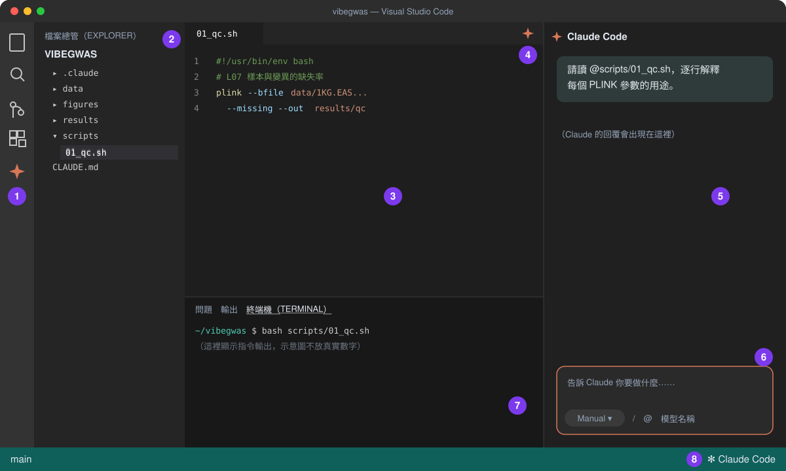

# VS Code 操作畫面導覽

本課程所有實作，預設都在 **VS Code 裡開啟 Claude Code 擴充套件** 操作。這一頁帶你從零安裝到送出第一個提示詞，每一步都附上要點的位置。

!!! info "本頁資料來源"
    操作步驟、按鍵與按鈕名稱取自 Claude Code 官方文件 [Use Claude Code in VS Code](https://code.claude.com/docs/en/vs-code)（2026-11-19 擷取）。介面會隨版本更新，按鈕名稱若對不上，以官方頁面為準。下方示意圖是本課程自繪，用來標位置，不是真實截圖；官方截圖請見[官方頁面最上方的畫面](https://code.claude.com/docs/en/vs-code)。

<figure markdown="span">
  { width="100%" }
  <figcaption>本課程自繪示意圖。編號說明見下表。</figcaption>
</figure>

| 編號 | 位置 | 用途 |
|---|---|---|
| 1 | 活動列（Activity Bar）的 Spark 圖示 | 打開 Claude Code 的對話清單，可以接續舊對話或開新對話。這個圖示一直都在。 |
| 2 | 檔案總管（Explorer） | 看專案資料夾裡的檔案。Claude 建立或修改的檔案會出現在這裡。 |
| 3 | 編輯器 | 開啟並閱讀 Claude 寫的腳本。選取幾行文字，Claude 會自動看到你選的內容。 |
| 4 | 編輯器工具列（右上角）的 Spark 圖示 | 最快打開 Claude Code 面板的方法。**只有開著檔案時才會出現。** |
| 5 | Claude Code 面板 | 跟 Claude 對話的地方。可以拖曳到左右側欄或編輯區。 |
| 6 | 提示框 | 輸入提示詞。下方會顯示權限模式、模型名稱、`/` 指令選單。 |
| 7 | 整合式終端機 | 自己執行指令、看輸出。用 `@terminal:名稱` 可以把終端機輸出交給 Claude 看。 |
| 8 | 狀態列右下角的「✻ Claude Code」 | 沒開檔案時也能打開 Claude Code。 |

## 一、安裝前準備

- [ ] VS Code **1.94.0 以上**。到 <https://code.visualstudio.com/> 下載安裝。
- [ ] 一個 Anthropic 帳號：任一種 Claude 付費方案（Pro、Max、Ultra、Team、Enterprise）或 Claude Console 帳號，不需要 API key。

## 二、安裝擴充套件

<span class="vg-step">1</span> 打開 VS Code，按 ++ctrl+shift+x++（Mac 是 ++cmd+shift+x++）打開「擴充功能」。

<span class="vg-step">2</span> 搜尋框輸入 `Claude Code`，找到 Anthropic 發行的那一個，按 **Install**。

<span class="vg-step">3</span> 裝好後如果沒看到 Spark 圖示，重新啟動 VS Code，或按 ++ctrl+shift+p++ 打開命令選擇區，執行 `Developer: Reload Window`。

!!! note "擴充套件和命令列版不一樣"
    擴充套件內含自己的一份 Claude Code，面板直接就能用。如果你想在 VS Code 的終端機裡輸入 `claude` 指令，還要另外安裝命令列版（見 [L02](chapters/L02.md)）。

## 三、打開專案資料夾

Claude Code 只能看到你打開的資料夾，所以每次上課先開對資料夾。

<span class="vg-step">1</span> 選單 **File → Open Folder…**（中文介面是「檔案 → 開啟資料夾」）。

<span class="vg-step">2</span> 選 `vibegwas` 資料夾（L02 會建立），按「選擇資料夾」。

<span class="vg-step">3</span> 第一次開啟時 VS Code 會問是否信任這個資料夾的作者。這是你自己建的資料夾，選信任。

## 四、打開 Claude Code 並登入

<span class="vg-step">1</span> 用下列任一方法打開面板：

=== "編輯器工具列（最快）"

    先在檔案總管點開任何一個檔案，再點編輯器右上角的 Spark 圖示（示意圖第 4 號）。

=== "活動列"

    點左邊活動列的 Spark 圖示（第 1 號），會打開對話清單，點「新對話」或任何一個舊對話。

=== "命令選擇區"

    按 ++ctrl+shift+p++（Mac ++cmd+shift+p++），輸入 `Claude Code`，選 **Open in New Tab** 等選項。

=== "狀態列"

    點視窗右下角的 **✻ Claude Code**（第 8 號）。沒開檔案時也可用。

<span class="vg-step">2</span> 第一次打開會看到登入畫面，按 **Sign in**，在跳出的瀏覽器頁面完成授權。

<span class="vg-step">3</span> 登入後會出現 **Learn Claude Code** 檢查清單，可以逐項按 **Show me** 看教學，也可以按 X 關掉。命令選擇區的 `Claude Code: Open Walkthrough` 也能叫出導覽。

## 五、送出第一個提示詞

<span class="vg-step">1</span> 在提示框輸入：

```text
請列出這個資料夾裡有哪些子資料夾，並說明每個資料夾在 GWAS 專案裡適合放什麼。
```

<span class="vg-step">2</span> 按 ++enter++ 送出。想換行而不送出，按 ++shift+enter++。

<span class="vg-step">3</span> 看 Claude 的回覆。如果它要執行指令或改檔案，會先徵求同意（取決於權限模式，見下一節）。

### 提示框的四個常用功能

| 功能 | 怎麼用 |
|---|---|
| 指定檔案 | 輸入 `@` 加檔名，例如 `@scripts/01_qc.sh`；資料夾在名稱後加 `/`，例如 `@results/` |
| 指定幾行程式 | 在編輯器選取那幾行，按 ++alt+k++（Mac ++option+k++），會插入像 `@01_qc.sh#3-4` 的參照 |
| 給它看終端機輸出 | 輸入 `@terminal:終端機名稱`，不用複製貼上錯誤訊息 |
| 附加檔案或圖片 | 按住 ++shift++ 把檔案拖進提示框；圖片可以直接從剪貼簿貼上 |

## 六、權限模式：決定 Claude 能不能自己動手

點提示框下方的模式名稱可以切換。

| 模式 | Claude 的行為 | 本課程建議 |
|---|---|---|
| **Manual** | 改檔案、執行大部分指令前都先問你 | **前 4 章用這個**，每一步都看清楚 |
| **Plan** | 先寫出計畫，等你同意才動手；VS Code 會把計畫開成 Markdown 文件，你可以直接加註解 | 開始一個新分析步驟前用 |
| **Edit automatically** | 改檔案不再問你 | 熟悉後、在 Git 有存檔時再用 |
| **Auto** | 由分類器審查大部分動作，代替逐一問你 | 熟悉後再用 |

在 Manual 模式下，Claude 想改檔案時會開出左右對照的差異畫面（diff）。每一處修改下方有 **Accept this change**（接受）和 **Reject this change**（拒絕）按鈕，也可以直接在右邊改內容再接受。

!!! tip "也可以打 `/plan`"
    在提示框輸入 `/plan 幫我規劃 L07 的 QC 流程`，會切到 Plan 模式並開始規劃這件事。

## 七、其他好用的按鈕

- **Session history**：面板上方，找回以前的對話。
- **`/` 指令選單**：點 `/` 或在提示框打 `/`，可以切換模型、附加檔案、管理 skill（`/skills`）和 plugin（`/plugins`）。
- **Context 用量**：提示框會顯示目前用掉多少對話記憶，快滿時 Claude 會自動壓縮，你也可以打 `/compact`。
- **多個對話**：命令選擇區選 **Open in New Tab**，每個分頁是獨立的對話，例如一個做 QC、一個查文獻。

## 下一步

- 照 [L02](chapters/L02.md) 建好 `vibegwas` 專案資料夾與 PLINK。
- 讀 [Vibe coding 操作技巧](tips.md)，學會怎麼下指令、怎麼檢查結果。
- 讀 [建立與安裝 Skill](skills.md)，把重複的步驟做成一鍵指令。
